# PostgreSQL relationships (revision 0030)

Generated by `python -m scripts.schema_erd` from a fully migrated PostgreSQL schema;
checked against a fresh migration in `tests/test_runtime.py`. No business records are read.

78 application tables and 202 physical foreign keys (excluding `alembic_version`).
Composite columns are joined with `+`. Cardinalities use nullability and unconditional PK/UNIQUE
constraints only. The diagram does not assert application authorization, partial uniqueness,
polymorphic references, immutable-history triggers, or every field in the frozen data dictionary.

```mermaid
erDiagram
    user_accounts ||..o{ account_status_changes : "account_id"
    user_accounts ||..o{ account_status_changes : "changed_by"
    user_accounts ||..o| agent_collection_versions : "account_id"
    user_accounts ||..o{ agent_credentials : "delegated_by"
    organizations ||..o{ agent_credentials : "org_id"
    agent_credentials ||..o{ agent_project_grants : "credential_id"
    user_accounts ||..o{ agent_project_grants : "granted_by"
    projects ||..o{ agent_project_grants : "project_id"
    user_accounts ||..o{ agent_security_events : "actor_id"
    agent_credentials ||..o{ agent_security_events : "token_id"
    agent_credentials ||..o| agent_token_versions : "token_id"
    organizations ||..o{ appointment_authorities : "org_id"
    persons ||..o{ appointment_authorities : "person_id"
    persons o|..o{ approval_requests : "decided_by"
    persons o|..o{ approval_requests : "delegated_by"
    projects ||..o{ approval_requests : "project_id"
    persons ||..o{ approval_requests : "requested_by"
    decisions o|..o{ audit_logs : "decision_id"
    user_accounts o|..o{ audit_logs : "delegated_by"
    organizations o|..o{ audit_logs : "org_id"
    projects o|..o{ audit_logs : "project_id"
    persons ||..o{ change_approval_grants : "person_id"
    projects ||..o{ change_approval_grants : "project_id"
    persons ||..o{ change_decision_records : "approver_id"
    change_entries ||..o| change_decision_records : "change_id"
    persons o|..o{ change_entries : "approved_by"
    persons ||..o{ change_entries : "created_by"
    projects ||..o{ change_entries : "project_id"
    persons ||..o{ change_entries : "requested_by"
    charters ||..o{ charter_versions : "charter_id"
    persons ||..o{ charters : "created_by"
    projects ||..o| charters : "project_id"
    cost_entries ||..o{ cost_baseline_history : "entry_id"
    projects ||..o{ cost_baseline_history : "project_id"
    persons ||..o{ cost_entries : "created_by"
    projects ||..o{ cost_entries : "project_id"
    persons ||..o{ cost_plan_versions : "created_by"
    projects ||..o{ cost_plan_versions : "project_id"
    cost_entries ||..o{ cost_postings : "cost_entry_id"
    persons ||..o{ cost_postings : "created_by"
    cost_postings o|..o{ cost_postings : "posting_of_id"
    projects ||..o{ cost_postings : "project_id"
    persons o|..o{ cost_postings : "verified_by"
    persons ||..o{ cost_reconciliation_grants : "person_id"
    projects ||..o{ cost_reconciliation_grants : "project_id"
    cost_reconciliation_grants ||..o{ cost_reconciliations : "grant_id"
    projects ||..o{ cost_reconciliations : "project_id"
    persons ||..o{ cost_reconciliations : "signed_by"
    persons ||..o{ decisions : "created_by"
    persons ||..o{ decisions : "decided_by"
    projects ||..o{ decisions : "project_id"
    reviews o|..o{ decisions : "review_id"
    persons ||..o{ evidence_files : "owner_id"
    projects ||..o{ evidence_files : "project_id"
    persons ||..o{ evidence_files : "uploaded_by"
    persons o|..o{ evidence_files : "verified_by"
    evidence_files ||..o| evidence_links : "evidence_id"
    facts ||..o{ fact_clarifications : "fact_id"
    persons ||..o{ fact_clarifications : "requested_by"
    persons o|..o{ fact_clarifications : "resolved_by"
    persons ||..o{ fact_history : "actor_id"
    fact_source_receipts ||..o{ fact_history : "fact_id to fact_id"
    facts ||..o| fact_source_receipts : "fact_id"
    persons ||..o{ facts : "created_by"
    projects ||..o{ facts : "project_id"
    reports ||..o{ facts : "report_id"
    health_appeals ||..o| health_appeal_decisions : "appeal_id"
    persons ||..o{ health_appeal_decisions : "reviewer_id"
    persons ||..o{ health_appeals : "appealed_by"
    persons o|..o{ health_appeals : "reviewed_by"
    health_snapshots ||..o{ health_appeals : "snapshot_id"
    projects ||..o{ health_snapshots : "project_id"
    persons ||..o{ health_zero_budgets : "declared_by"
    projects ||..o{ health_zero_budgets : "project_id"
    persons o|..o{ idempotency_keys : "delegated_by"
    organizations o|..o{ idempotency_keys : "org_id"
    persons o|..o{ lessons : "confirmed_by"
    persons ||..o{ lessons : "created_by"
    projects ||..o{ lessons : "project_id"
    persons ||..o{ milestone_completions : "completed_by"
    evidence_links ||..o{ milestone_completions : "evidence_id to evidence_id"
    milestones ||..o| milestone_completions : "milestone_id"
    rule_events ||..o| milestone_delay_episodes : "event_id"
    milestones ||..o{ milestone_delay_episodes : "milestone_id"
    milestone_forecasts o|..o{ milestone_delay_episodes : "milestone_id+opening_revision to milestone_id+revision"
    persons ||..o{ milestone_forecasts : "created_by"
    milestones ||..o{ milestone_forecasts : "milestone_id"
    persons ||..o{ milestones : "created_by"
    projects ||..o{ milestones : "project_id"
    projects ||..o{ notifications : "project_id"
    persons o|..o{ notifications : "read_by"
    persons ||..o{ notifications : "recipient_person_id"
    rule_events o|..o{ notifications : "rule_event_id"
    outbox_events ||..o| organization_event_inbox : "event_id"
    organizations ||..o{ organization_event_inbox : "org_id"
    user_accounts o|..o| organization_user_invitations : "account_id"
    user_accounts ||..o{ organization_user_invitations : "issuer_id"
    organizations ||..o{ organization_user_invitations : "org_id"
    user_accounts o|..o{ organization_user_invitations : "revoked_by"
    outbox_events ||..o{ outbox_attempts : "event_id"
    persons ||..o{ persons : "created_by"
    organizations ||..o{ persons : "org_id"
    user_accounts o|..o| persons : "user_id"
    outbox_events ||..o| project_event_inbox : "event_id"
    projects ||..o{ project_event_inbox : "project_id"
    persons ||..o{ project_members : "assigned_by"
    persons ||..o{ project_members : "person_id"
    projects ||..o{ project_members : "project_id"
    persons o|..o{ project_retrospectives : "confirmed_by"
    projects ||..o| project_retrospectives : "project_id"
    projects ||..o| project_rule_scan_state : "project_id"
    persons ||..o{ project_stage_transitions : "actor_id"
    project_transition_intents o|..o| project_stage_transitions : "approval_request_id to approval_id"
    projects ||..o{ project_stage_transitions : "project_id"
    review_submission_snapshots o|..o{ project_stage_transitions : "review_id to review_id"
    project_transition_intents ||..o| project_termination_confirmations : "approval_id to approval_id"
    project_members ||..o{ project_termination_confirmations : "assignment_id"
    persons ||..o{ project_termination_confirmations : "signer_id"
    approval_requests ||..o| project_transition_intents : "approval_id"
    project_transition_intents ||..o| project_transition_outcomes : "approval_id to approval_id"
    decisions ||..o| project_transition_outcomes : "decision_id"
    persons ||..o{ projects : "created_by"
    persons ||..o{ projects : "initiator_id"
    organizations ||..o{ projects : "org_id"
    persons o|..o{ projects : "pm_id"
    persons o|..o{ projects : "sponsor_id"
    tasks o|..o{ report_analysis_runs : "fallback_task_id"
    projects ||..o{ report_analysis_runs : "project_id"
    reports ||..o{ report_analysis_runs : "report_id"
    user_accounts ||..o{ report_analysis_runs : "requested_account_id"
    persons ||..o{ report_analysis_runs : "requested_by"
    web_sessions ||..o{ report_analysis_runs : "requested_session_id to session_id"
    persons ||..o{ reports : "author_id"
    persons o|..o{ reports : "confirmed_by"
    persons ||..o{ reports : "created_by"
    projects ||..o{ reports : "project_id"
    persons o|..o{ reports : "submitted_by"
    projects ||..o{ requirement_baseline_signatures : "project_id"
    persons ||..o{ requirement_baseline_signatures : "signer_id"
    project_members ||..o{ requirement_disputes : "assignment_id"
    persons ||..o{ requirement_disputes : "customer_id"
    projects ||..o{ requirement_disputes : "project_id"
    requirements ||..o{ requirement_disputes : "requirement_id"
    stakeholders ||..o{ requirement_disputes : "stakeholder_id"
    persons ||..o{ requirement_exception_events : "actor_id"
    project_members ||..o{ requirement_exception_events : "assignment_id"
    evidence_files o|..o{ requirement_exception_events : "evidence_id"
    projects ||..o{ requirement_exception_events : "project_id"
    requirement_exception_events o|..o| requirement_exception_events : "project_id+revokes_id to project_id+id"
    persons ||..o{ requirement_transitions : "actor_id"
    evidence_links ||..o{ requirement_transitions : "evidence_id to evidence_id"
    requirements ||..o{ requirement_transitions : "requirement_id"
    persons o|..o{ requirements : "accepted_by"
    persons ||..o{ requirements : "created_by"
    projects ||..o{ requirements : "project_id"
    persons ||..o{ review_appeals : "requested_by"
    review_submission_snapshots ||..o| review_appeals : "review_id to review_id"
    persons ||..o{ review_confirmations : "confirmed_by"
    review_submission_snapshots ||..o{ review_confirmations : "review_id to review_id"
    approval_requests ||..o| review_decision_snapshots : "approval_request_id"
    decisions ||..o| review_decision_snapshots : "decision_id"
    review_submission_snapshots ||..o| review_decision_snapshots : "review_id to review_id"
    review_submission_snapshots ||..o{ review_strengthening_tasks : "review_id to review_id"
    tasks ||..o| review_strengthening_tasks : "task_id"
    reviews ||..o| review_submission_snapshots : "review_id"
    persons ||..o{ reviews : "created_by"
    projects ||..o{ reviews : "project_id"
    persons ||..o{ risk_handoff_acceptances : "actor_id"
    evidence_links ||..o{ risk_handoff_acceptances : "evidence_id to evidence_id"
    projects ||..o{ risk_handoff_acceptances : "project_id"
    persons o|..o{ risk_handoff_acceptances : "receiver_id"
    risk_handoff_acceptances o|..o{ risk_handoff_acceptances : "request_receipt_id"
    project_members o|..o{ risk_handoff_acceptances : "reviewer_assignment_id"
    risks ||..o{ risk_handoff_acceptances : "risk_id"
    risk_handoff_acceptances o|..o{ risk_resolutions : "acceptance_id"
    persons ||..o{ risk_resolutions : "actor_id"
    evidence_links ||..o{ risk_resolutions : "evidence_id to evidence_id"
    projects ||..o{ risk_resolutions : "project_id"
    persons o|..o{ risk_resolutions : "receiver_id"
    project_members o|..o{ risk_resolutions : "reviewer_assignment_id"
    risks ||..o{ risk_resolutions : "risk_id"
    persons ||..o{ risks : "created_by"
    persons o|..o{ risks : "handoff_to_id"
    persons o|..o{ risks : "owner_id"
    projects ||..o{ risks : "project_id"
    persons o|..o{ role_invitations : "issuer_id"
    persons ||..o{ role_invitations : "person_id"
    projects ||..o{ role_invitations : "project_id"
    persons ||..o{ role_invitations : "proposer_id"
    projects ||..o{ rule_events : "project_id"
    persons ||..o{ scorecards : "created_by"
    projects ||..o{ scorecards : "project_id"
    reviews ||..o{ scorecards : "review_id"
    persons ||..o{ scorecards : "reviewer_id"
    persons ||..o{ stakeholders : "created_by"
    persons o|..o{ stakeholders : "linked_person_id"
    projects ||..o{ stakeholders : "project_id"
    persons o|..o{ tasks : "assignee_id"
    persons ||..o{ tasks : "created_by"
    projects ||..o{ tasks : "project_id"
    user_accounts ||..o{ user_roles : "user_id"
    user_accounts ||..o{ web_sessions : "account_id"
```

Tables without a physical foreign-key edge:

- `login_windows`
