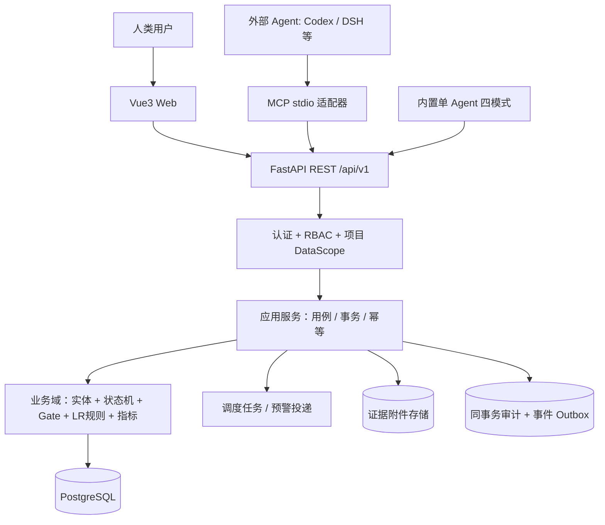
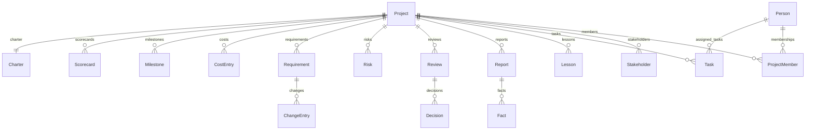

# PMO 项目管理系统 V1.0｜独立系统完整开发方案

> 规格版本：`PMO-Standalone-1.0.4（第四轮最终审定版）`；方案日期：2026-11-19。  
> 来源基线：《PMO 本体设计方案 · 轻量版 v1.0-Lite》（2026-11-13），本包内保留原始 HTML。  
> 目标：**独立 Web 项目管理系统；用户经 Web 操作，Agent 经 MCP 访问；两者复用同一业务服务、规则、权限与审计。**  
> 标记说明：【原文】忠实保留原始业务要求；【实施定版】为使系统可开发，本方案补充的工程约定；【勘误/冲突处置】对原文不一致处的明确处理。原文业务优先；如业务负责人要变更定版值，须更新规则版本及回归测试，不得默改。

## 0. 开发结论与不可突破边界

### 0.1 业务目标【原文】
- 回答四问：**值不值得做、能不能做成、实施中进度/成本/需求如何、完成后学到什么**。
- 保留 **16 个本体业务类、三道关口、LR-01～LR-08 八条规则、一个 PMO Agent 四模式、Report→Fact→核验→汇总**。
- 管理颗粒度：**项目、≤8 个里程碑、需求**。不引入 Portfolio、Program、WBS、复杂资源调度、多治理机构、图数据库、通用多 Agent 编排。
- 人可以在完全不调用大模型时完成全部立项、过程、验收、结项流程；AI 只做辅助分析/提议与受控操作。

### 0.2 交付边界【实施定版】
- **在范围内**：独立登录/角色及项目授权、项目 CRUD（任何有效认证人员可发起草稿）、立项卡、评分及三关口、里程碑、需求与变更、双口径成本（候选凭证独立核验）、风险、补强任务、日报周报、Fact 证据、三线状态、预警通知、结项回顾及 Lesson、单 Agent 四模式、MCP stdio 接入（完整草稿工具链）、审计、备份与自动测试。
- **不在 V1.0 内**：多租户 SaaS 计费、合同/发票开具、财务付款执行、工时打卡或薪酬、甘特图关键路径、研发 Issue/Sprint、跨项目负载优化、自动客户电子签章、多语言、移动 App、任意 SQL 查询 MCP、自动审批、复杂流程引擎、微服务及 HTTP 公网 MCP 暴露。
- **部署定位**：公司内部/小团队，管理项目数目标 `<15`；多人登录，多 Agent 可以各自授权访问。项目数上限作为目标规模，不在数据库施加阻止新增的硬上限。
- **MCP V1.0**：本机 Agent 通过 `stdio` 连接 MCP 适配器；适配器使用带作用域的授权凭据调用后端 REST API。`Streamable HTTP` 留给 V1.1（须完成 OAuth/OIDC、Origin 校验和客户端兼容验收），不为首版交付增添公网风险。

### 0.3 必须保持的体系结构【实施定版】

- **不得**在前端、MCP 或 LLM 提示词里复制业务规则的权威实现。服务端 `Domain` 是唯一判定来源。
- **状态变更入口区分**：唯一写入函数为 `transition_project()`；审批接口完成最终关口裁决时在同一事务调用它，普通 `/transitions` API 用于已授权的非关口迁移/已生效决议执行，禁止直接更新 `projects.stage`。
- 非关键的 AI 运行失败不得阻塞人工 CRUD/评审/结项；正式计算不得用自由文本模型推断代替。

## 1. 技术栈及具体取舍【实施定版】

| 层次 | V1.0 固定方案 | 不采用相邻方案的原因 / 约束 |
|---|---|---|
| Web | Vue 3 + TypeScript + Vite + Element Plus | 企业表单、列表、审批操作适配好；不需要 React Flow 或复杂可视化画布 |
| API | Python 3.12 + FastAPI + Pydantic v2 | API 契约清晰，复用 Python 证据抽取和 MCP 生态；严禁规则写在路由或工具内 |
| ORM/迁移 | SQLAlchemy 2 + Alembic | 关系建模与事务、迁移可复现；每次模型变化必须提供迁移和回滚验证 |
| DB | PostgreSQL | 强约束、事务、关联数据；如已建 MySQL 系统，可以在 M0 经评估替换，但**不得在实现中同时维护两套** |
| 身份 | 服务端 Session Cookie + Argon2id 密码散列；项目级 RBAC/DataScope | Web 使用 HttpOnly/Secure/SameSite Cookie + CSRF；MCP 用独立短期作用域 Token，不复用浏览器 Cookie |
| MCP | Python MCP SDK，V1.0 stdio；M0 先固定已核实的 `mcp==2.3.0` 做兼容候选，再以真实 Host 测试确定最终锁版本；调用相同 REST API | 不重复构建第二套业务服务；外部工具明确白名单与结构化返回 |
| AI | 一个 PMO Agent，四份模式指令，结构化抽取走 Pydantic 校验 | 不依赖 LangGraph、向量库或多 Agent 判决；模型提供建议不负责权威计算 |
| 后台任务 | 独立定时任务进程 + 数据库锁 + Outbox | 8 条规则规模无需 Celery/Redis；任务幂等，重启可补跑 |
| 附件 | 本地私有存储卷 + SHA-256 + DB 元数据 | 证据不能通过公开静态路径读取；扩展时迁移到对象存储即可 |
| 部署 | Docker Compose（Web、API、DB、Scheduler）；MCP stdio 客户端侧安装 | 本地开发以命令热重载运行，不强制每次改动打包 |
| 测试 | pytest、类型检查、Playwright E2E、MCP 客户端集成测试 | 覆盖逻辑、越权、事务、并发和跨入口一致性 |

**注意**：锁定主版本后，将实际验收使用的精确依赖版本写入 lockfile；不得仅写“latest”。生产环境使用 HTTPS，数据库不得对公网暴露。

## 2. 完整业务模块及 Web 交互【原文范围 + 实施定版交互】

| ID | 模块/页面 | 必须可操作的能力 | 业务来源 |
|---|---|---|---|
| UI-01 | 工作台 `/dashboard` | 在管项目数量、状态灯、异常、待审批、待补强任务、数据更新时间 | §1/§4/§7 |
| UI-02 | 项目列表 `/projects` | 创建、检索、筛选、角色允许范围内项目；查看负责人/阶段/灯色 | Project |
| UI-03 | 项目概览 `/projects/:id` | 立项信息概要、时间钱人天需求四指标、状态迁移、最近活动 | §1/§4 |
| UI-04 | 立项卡 | 编辑草稿、补全校验、提交立项评审、看历史教训 | Charter/§3.1 |
| UI-05 | 评审中心 `/reviews` | 待评、评分理由、评审结果、复议、历史决议、例外审批 | Scorecard/Review/Decision |
| UI-06 | 方案与里程碑 | 草稿可录入 0～8 个有效里程碑；**送落地评审前至少 3 个**；显示计划/预测/实际、逾期与证据 | Milestone/§1.2 |
| UI-07 | 需求与变更 | 需求 P0/P1/P2、验收标准、提交变更、基线版本/变更时间线 | Requirement/ChangeEntry |
| UI-08 | 成本与人天 | 钱和人天分别查看预算/实际/剩余预测/偏差；填写来源凭证 | CostEntry |
| UI-09 | 风险与补强任务 | 风险等级、阻塞时长、责任人、整改任务、关闭或移交 | Risk/Task |
| UI-10 | 日报周报及证据 | 定型区块填报、AI Fact 草稿、出处核验、澄清冲突、发布周报 | Report/Fact/§5 |
| UI-11 | 交付与结项 | 需求逐条验收、客户确认、结项门槛预检查、最终结项裁决 | §3.3 |
| UI-12 | 复盘与教训库 | 复盘四问、Lesson 审核及归档、按类别/关键词检索 | Lesson/§2.2 |
| UI-13 | 预警中心 | 每条规则触发源、输入快照、负责人、通知、处理/申诉历史 | §4 |
| UI-14 | 系统管理 | 用户/角色/项目成员、Agent 令牌、规则版本、通知设置、审计日志 | 独立系统新增 |
| UI-15 | 内置 PMO 助手 | 四模式切换、对话、来源引用、建议动作预览、审批状态 | §6 |

**交互统一规则**：加载/空态/报错明确；危险操作需二次确认；提交后显示真实 `operation_id`；刷新后能恢复数据；权限不足不能展示操作按钮，后端还必须独立拒绝。首页最多两级导航，项目业务在详情页使用标签组织。

## 3. 16 类领域实体：字段与关系冻结

### 3.1 字段规范【实施定版】
- API JSON 统一 camelCase，物理列 snake_case。所有领域主表统一 `id UUID`、`created_at timestamptz`、`updated_at timestamptz`、`created_by UUID`、`revision bigint >=1`（派生记录可不必更新版本）。
- 项目编号 `code` 在组织内唯一；组织内用户权限范围基于 `project_members` 实施。时间点用 `timestamptz` 按 UTC 保存，纯日历日期用 `date` 按项目时区解释，展示采用组织默认 `Asia/Shanghai`。
- 金额 `numeric(18,2)`，单位固定 CNY（本版只支持人民币）；人天 `numeric(12,2)`（1 人天 = 8 小时，用于统计口径，非薪酬折算）；评分整数 1～5；权重和偏差用 Decimal/NUMERIC，不用 float；`forecast` 统一指**预计剩余消耗**。
- 高价值业务历史采用追加版本和审计；删除只执行软删除/状态取消，不得物理删除已被报告/评审/凭证引用的记录。

### 3.2 实体字典（保留原文 16 类名称）
| 类 | 必须落地的核心字段（增补用 `+` 标记） | 关键约束 |
|---|---|---|
| 01 Project | `code,name,sponsor,pm,stage,createdAt` + `orgId,description,revision` | 项目编号唯一；stage 仅状态机修改；**drafting 允许 sponsor/pm 暂为空；创建者具有本人草稿编辑权；送审前两者须为有效且已接受任命的 Person** |
| 02 Charter | `valueProp,targetClient,expectedBenefit,successCriteria,roughCost,roughEffort,roughDuration` + `attractiveness,topRisks,revision,isFrozen` | 草稿阶段可分步保存；每项目当前有效立项卡 1 份；**送立项评审前**字段齐全、至少一风险、Sponsor/PM 已落实 |
| 03 Scorecard | `type,dimensions{score},total,verdict,reviewer,reviewedAt` + `reviewId,rationale,ruleVersion` | 每维 1～5，选择锚点并填理由；系统计算总分；复议仅一次 |
| 04 Milestone | `name,plannedDate,forecastDate,actualDate,isKey` + `projectId,ordinal,evidenceRef` | 每项目**有效**里程碑最多 8 条；历史取消记录保留且必须经变更；方案送审至少 3 条有效记录且至少 1 条 isKey=true；冻结计划修改须获批 |
| 05 CostEntry | `type,category,budget,actual,forecast,period` + `projectId,sourceRef` | type=money/effort；实际消耗只汇总已核验/正式入账的不可变明细；候选填报不进入正式指标；不能重复记账 |
| 06 Requirement | `desc,priority,acceptanceCriteria,status,acceptedBy,acceptedAt` + `projectId,plannedConfirmAt,baselineVersion,evidenceRef` | P0/P1/P2；状态按验收流程；冻结后更改须 ChangeEntry |
| 07 ChangeEntry | `target,before,after,reason,approvedBy` + `projectId,targetType,targetId,status,requestedBy,effectiveAt` | 覆盖需求/里程碑/预算/立项卡基线；获批后才生效，保留旧值 |
| 08 Risk | `statement,prob,impact,response,owner,isBlocking,blockedSince` + `projectId,status,handoffTo,closedAt` | 阻塞风险结项前关闭或正式移交接收人 |
| 09 Review | `type,scheduledAt,attendees,verdict,minutes` + `projectId,purpose,status,round` | type=charter/feasibility/closing；完整裁决留痕 |
| 10 Decision | `subject,option,rationale,decidedBy,decidedAt` + `reviewId,evidenceRef,exceptionPayloadHash` | 任何关口人工裁决必有 Decision；禁止模型生成“已批准” |
| 11 Report | `type,author,period,structuredFields,narrative` + `projectId,status,submittedAt` | type=daily/weekly；每周报告按项目按周期唯一有效版本 |
| 12 Fact | `subject,predicate,value,asOf,quote,sourceRef,trust` + `reportId,projectId,validationStatus` | 原文引用/来源定位必填；低可信与冲突事实不参与正式计算 |
| 13 Task | `title,assignee,dueAt,source,status` + `projectId,sourceType,sourceId,completedAt` | 仅补强/整改/预警处置任务，不扩展 Sprint/WBS |
| 14 Lesson | `category,what,rootCause,advice,projectRef` + `confirmedBy,confirmedAt,status` | 人确认后入库；归档前至少一条已确认 Lesson |
| 15 Person | `name,role,org` + `userId,isActive` | Person 是组织身份/责任人；不等于登录凭据 |
| 16 Stakeholder | `name,type,influence,expectation` + `projectId,linkedPersonId,contactRole` | type=客户/合作方/内部；可关联认证的客户代表 |

**【勘误/冲突处置】** 原文宣称「12 关系」，但 §2.1 列举展开为 `Project→Charter` 1 条、`Project→8 类` 8 条、其余 `Requirement→ChangeEntry` / `Review→Decision` / `Report→Fact` / `Task→Person` 4 条，合计 **13 个列举关系项**。本方案如实落地这 13 项，不因数字笔误删关系；另补 `Project→Task`、`Project→Stakeholder`、`Project↔Person (membership)` 和成员审核人关联。原文“主表 + 8 子表”属于表格载体计划，独立系统不据此削减 16 类实体。

### 3.2.1 领域关系示意（16 类 + 明确的项目关联）

其中前 13 个关联为原文逐项展开的关系，后 4 个是为了独立系统项目关联与成员权限必须补齐的关系。`ProjectMember` 为技术关联表，不计入 16 个业务类。ERD 只表示基数，权限与状态变更仍由应用服务执行。

### 3.3 必要的技术附属表（**不计入 16 类业务本体**）
- `user_accounts`：邮箱/用户名、密码哈希、锁定和状态。
- `project_members`、`user_roles`、`agent_credentials`：项目级角色、授权范围、令牌摘要、过期和撤销记录。`project_members` 增加 `assignment_status=pending/accepted/declined/revoked` 和 `assigned_by,accepted_at`，Sponsor/PM 任命必须由具有组织授权者发起、本人接受后生效；草稿 creator 的本人编辑权不等于上述角色。
- `approval_requests`：申请负载哈希、签核顺序、申请/审批/失效状态，最终业务裁决仍记到 Review/Decision。
- `cost_postings`：每笔钱/人天入账候选，状态 `draft/pending/verified`（`reversed` 仅为原凭证被冲销后的派生显示状态，不直接更新原始流水），保留 `evidenceRef,createdBy,verifiedBy,verifiedAt,postingOf`；**将全部已核验的有符号流水（含反向冲销流水）只汇总一次，才形成 `CostEntry.actual` 的净额**；原始凭证不可修改，纠错走引用原记录的冲销。Agent 只可提交候选，不能核验自身候选。
- `evidence_files`：文件存储键、hash、类型、关联业务对象、核验人、可见性。
- `health_snapshots`、`rule_events`：三线输入/输出/版本/时点及 LR 事件；历史不可覆盖。
- `audit_logs`、`idempotency_keys`、`outbox_events`、`notifications`：操作审计、重复写入保护、通知可靠投递。
- `fact_clarifications`：低可信或相互矛盾的 Fact 澄清任务和关闭记录。

**关系完整性**：所有项目关联记录有 `project_id FK`；`project_members` 唯一键 `(project_id, person_id, role)`（一个人可承担多个被授权角色，角色授权保持独立）；Scorecard 唯一键 `(review_id, reviewer_id, round)`；Report 每项目每自然周期只有一个当前有效提交版本；证据引用不因业务软删除失效。

## 4. 项目状态机和三道关口【原文规则 + 明确补充】

### 4.1 状态枚举与合法迁移【实施定版】

| 当前状态 | 允许的下一状态 | 强制条件 / 审批 |
|---|---|---|
| `drafting` | `charter_review` | Charter 全部必填；至少一条 topRisk；提交申请 |
| `charter_review` | `designing` | 立项评审通过/有条件通过；Decision；快通须发起人确认 |
| `charter_review` | `drafting` / `rejected` | 暂缓/方向调整→补材料；不通过→拒绝并记录理由 |
| `rejected` | `drafting` / `terminated` | 被拒后 30 自然日内最多一次重新送审；逾期或再次拒绝→终止 |
| `designing` | `feasibility_review` | 3～8 个里程碑、≥1 条已共同确认的需求基线、钱/人天预算、风险清单 |
| `feasibility_review` | `executing` | 五维均 >2；通过或有条件通过；有条件项形成 Task（责任人+期限） |
| `feasibility_review` | `designing` / `terminated` | 短板不通过→设计返工；终止需发起人确认并记录决议 |
| `executing` | `on_hold` / `delivering` / `terminated` | 暂停/终止须人批准；进入交付需所有里程碑实际完成并有凭证 |
| `on_hold` | `executing` / `terminated` | 恢复/终止需记录原因、发起人或授权人决定 |
| `delivering` | `closing_review` / `executing` | 提交客户验收记录并发起结项检查；退回则返工 |
| `closing_review` | `closed` / `executing` / `terminated` | 三门槛全部通过或合法条件结项；不通过返工 |
| `closed` | `retrospective` | 发起复盘；计算结项后 14 自然日提醒期限 |
| `terminated` | `retrospective` | 必须有终止原因及人工 Decision；执行终止复盘 |
| `retrospective` | `archived` | 至少 1 条已人工确认 Lesson，复盘四问完成 |
| `archived` | 无 | 只读；修订须经受控后续更正记录，不重新进入项目执行 |

**【勘误/冲突处置】** `approved`、`redesign`、`rejected` 在原文中混用为状态/裁决：本版将 `approved`、`redesign` 解释为 Review/Decision 的**裁决语义**；保留 `rejected` 项目状态以覆盖立项明确拒绝。所有后端迁移均由 `transition_project()` 服务执行，禁止直接 PATCH `stage`。

### 4.2 关口①立项【原文，边界值定版】
- 四个维度：战略对齐 20%、客户/市场吸引力 30%、财务/资源回报 25%、风险可控度 25%；每维整数 1～5，选择锚点并填写理由、证据。
- 每位评审人独立提交 Scorecard；每维 `S1～S4` 取本轮有效评审人该维分数的**算术平均值**（最少一名有效评审人），保留逐人原始评分。加权综合分：`0.20*S1 + 0.30*S2 + 0.25*S3 + 0.25*S4`，**计算不提前四舍五入，展示最后保留两位小数，阈值基于未舍入原值比较**。
- **否决优先**：任何有效评分卡存在一个维度=1，不能自动得出通过建议。提交一次复议（保留前后两版），仍未消除则不通过。
- 总分 `>=4.2`：建议快速立项，但仍需发起人确认、评审备案和 Decision；`3.2<=S<4.2`：建议通过并自动创建低分补强任务；`S<3.2`：建议拒绝/返工；审核人员最终裁决（不得与硬否决矛盾）。
- 原文只定义 1、3、5 分锚点，**2 = 高于 1 分锚点但未达到 3 分锚点；4 = 高于 3 分锚点但未达到 5 分锚点**，必须要求评审人选择并填写与原始证据相符的理由；不捏造原文缺失的具体业务描述。**普通通过后，四维中平均分 ≤3 的维度定义为低分项并产生补强 Task（这一定义为实施默认值，待业务签核）**。

### 4.3 关口②可落地性【原文】
- 五维：技术路径、资源匹配、外部依赖、时间合理性、验收标准；逐项整数 1～5，必须填写证据/理由。
- **任一有效评审的任一维 ≤2 → 不得通过**。通过及有条件通过仅在全部维度 >2 时允许；有条件通过必须逐条产生 `Task(assignee, dueAt, source=review)`，逾期未完成发黄色提示。
- 标准裁决枚举：`pass / conditional_pass / defer / redirect / reject`；不通过返回 `designing`，不得假装通过进入 `executing`。

### 4.4 关口③结项【原文 + 明确例外契约】
正常结项需**同时**满足：
1. 所有当前有效 P0 需求客户确认率 100%；加权满足率 ≥90%。
2. 金额和人天最终偏差的**绝对值**均 ≤20%；结项前实际流水已对账，剩余预测额应为 0（未归零的已承诺后续成本必须纳入书面结项例外）；如超支仍须说明归因（估算/执行/范围）。
3. 阻塞风险全部关闭，或具有移交运营清单与**接收方明确确认**。

**条件结项（例外）**：严格限于原文明确允许的**需求缺口经客户书面接受**；例外对象必须包含每条缺口 Requirement ID、偏差内容及接受证据；**不能用一个 `signedException: true` 布尔值代替结项校验**；须客户代表签署可验证证据，在 Decision 标明接受的具体需求/偏差，且有授权评审人 `conditional_pass` 与申请快照哈希。**成本超过 20% 不因 Sponsor 出具说明就能跳过成本门槛**：先按 LR-04 重新评估是否继续，若存在真实且获批的范围/预算变更，应通过 ChangeEntry 形成有效预算版本，重新评估后同时呈现原基线偏差和当前批准基线偏差；没有合法预算修订或仍超门槛则 LR-07 必须拒绝结项。阻塞风险仍须关闭或获运营接收方确认。Agent 无权制造上述任何确认。

### 4.5 状态机的并发与原子性
- 每次迁移强制 `expectedRevision`；冲突返回 HTTP 409 `VERSION_CONFLICT`；**合法执行**时申请、决议、迁移与成功审计在同一事务。非法请求应先回滚业务事务，再记录 `denied` 审计，不得试图在被回滚事务内永久保存拒绝事件。
- 同一关口裁决不能重复生效；每条写命令有 `idempotencyKey`（作用域：actor+operation+key），重试返回首次结果。
- 一旦提交评审，对应材料生成只读快照（关口所依赖的实体 ID、revision、有效基线 ID、规则版本与 canonical payload hash）；评审中的相关变更需撤回并重新提交，不允许评分针对过期数据。**只校验与此决策相关的快照依赖，避免无关任务更新导致审批无故过期**。

## 5. 指标、基线、三线和 LR-01～LR-08【原文主体 + 实施定版】

### 5.1 三线计算所需统一输入
- `calculatedAt`：计算 UTC 时间；`asOf` 为业务截止时间；`ruleVersion`、关联实体 revision、sourceRefs、计算输入快照和结果必须一同保存。
- 货币与人天**分开核算**；总项目灯色包括三个管理维度：**时间、成本（由钱和人天两口径合成）、质量**。Q2 始终单独展示「时间、钱、人天、需求满足率」四项。
- **需求基线**：在方案送审前由 PM 和有权客户代表共同确认，冻结初始版本。批准的 ChangeEntry 生成新有效版本；保留全部旧版本，不允许用直接覆盖规避变更。
- **时间计划基线**：方案评审时冻结 `plannedDate`；`forecastDate` 允许更新，但必须带原因/审计；更改 `plannedDate` 须走 ChangeEntry。
- **成本预算基线**：方案评审时冻结钱、人天的 `budget`；已发生消耗走不可变明细；预测为**剩余预估**，不得把预计总额再次加到 actual。

### 5.2 时间线（Time）
- 对未完成的**关键里程碑**计算 `delayDays=max(0, forecastDate-plannedDate)`（按项目本地自然日）。已完成里程碑记录实际延误入历史，但不再作为当前未完成里程碑逾期项。
- 若任何未完成关键里程碑 `plannedDate < 今天`，视作已逾期 → 红；否则 `delayDays>10` 红，`4<=delayDays<=10` 黄，`delayDays<=3` 绿。
- `forecastDate` 缺失时默认本次有效 `plannedDate`，但记录 `forecastMissing=true`；如未填且已过计划日仍红。正式缺失与来源不可信按 LR-06 另行处理。
- 计划日期基线变更必须有已批准 ChangeEntry，原计划仍在审计与快照中可查。

### 5.3 成本线（Money + Effort）
对每个口径分别算：

```text
projected_total = actual_to_date + forecast_remaining
variance_rate = (projected_total - approved_budget) / approved_budget
```

- `approved_budget>0` 时使用 Decimal 计算，展示百分比保留 2 位，仅展示时四舍五入，阈值判定使用未舍入值。`actual_to_date` 只从**所有 verified 有符号流水的总和**取得，包括原始正向流水及对应 verified 负向冲销流水，**不能“排除原流水”后再减冲销**；候选草稿、pending 和未核验冲销均不计入。
- `budget=0,actual=0,forecast=0` 且存在经 PM 声明的零预算理由 → 绿；**没有有效声明则 `untrusted`，不能把缺少预算当作零预算**；`budget=0,projected_total>0` → 红且需要预算变更/解释；预算缺失或消耗数据不可核验 → 数据不可信，不得当绿灯。
- 成本绿 `variance<=5%`、黄 `5%<variance<=15%`、红 `variance>15%`；负偏差默认绿，但在结项时按绝对偏差进行对账解释。
- 成本总体灯色=钱、人天两口径中较严重者；任一口径超 15% 触发 LR-04 红色预警；**严格超过 20%** 生成继续投入/重估立项的待办，但不改原始 Charter 承诺。

### 5.4 质量线与需求满足率
- 生效权重：P0=3，P1=2，P2=1。
- `active_baseline` = 初始基线 + 已批准新增项 − 已批准取消项；已批准修改要求保留同一需求 ID 的版本历史。
- `satisfaction = sum(weight of customer_confirmed active requirements) / sum(weight of active baseline requirements)`；分母为零 → `UNAVAILABLE` 并阻止结项，不得显示 100%。
- **未批准的范围变动**：需求状态冻结，不能进入已确认分子；原基线要求继续留在分母，防止故意删除难做需求提高满足率；生成 LR-05 事件。已批准取消项才从当前分母移除，但进入变更率统计。
- `changeRate = 有效的已批准变更涉及的不同初始需求数量 / 初始基线需求数`；**初始基线条数为零时返回 UNAVAILABLE 而非除零**；如需计新增需求次数，则以附加指标 `approvedChangeCount` 展示，避免混淆。
- 每个基线 Requirement 必须登记计划客户确认日 `plannedConfirmAt`；以项目本地自然周计算是否按计划确认。按原文：已达到计划 → 绿；滞后一个周报周期 → 黄；**任何 P0 尚未客户确认或客户存在正式争议 → 红**。补充边界：非 P0 滞后两个及以上周期也红。
- **重要原文风险**：原文将“存在未确认 P0”直接判为红灯，即项目实施初期可能长时间显示红灯。本版为了严格符合源文，**默认保留该规则**；若试点发现误报，须由业务方批准规则版本 `quality_p0_due_only`，不可由工程师在代码中私自改成“只有到期 P0 才红”。

### 5.5 合成灯色及可信度优先级
1. LR-06 判断当前证据/周报持续缺失：状态 `untrusted`（数据不可信），暂停正式三线发布；保留上一次有效快照作历史参考，但不当作本次绿灯。
2. 若输入可信：任一线红 → 项目红；否则两条或以上线黄 → 项目黄；否则项目绿。**严格保留原文“一条黄而无红则绿”的特殊合成规则**，工作台仍展示独立的黄线细节。
3. 严重违反硬规则时拒绝业务操作；业务健康状态不能用“绿”替代 Gate 通过证明。

### 5.6 八条规则：触发 → 行为 → 事务/通知

| ID | 类型 | 准确触发条件 | 系统执行结果 | 最低测试 |
|---|---|---|---|---|
| LR-01 | 硬 | 请求跨过任一关口或尝试非法状态转换 | **拒绝并回滚业务事务**；拒绝审计使用独立安全事务记录 `denied`（不是与回滚事务同提交） | Web/MCP 跳关均 409/422 |
| LR-02 | 硬 | 落地评审任何生效维度分 ≤2，仍申请通过 | 拒绝通过；补强 Task 按低分维度和负责人去重创建（可独立提交整改 Task 与审计，但不得改变评审通过状态） | 2 分被拒；3 分可评议 |
| LR-03 | 预警 | 关键里程碑预测晚于有效计划日，且无对应获批变更/计划修正 | 发黄事件通知 PM，不覆盖由三线计算得出的更严重红灯；要求记录偏差原因/计划处理 | 黄事件不降级红灯 |
| LR-04 | 预警 | money 或 effort `variance>15%` | 红事件通知 Sponsor；`>20%` 生成重估/继续投入审核待办 | 15%、20% 边界 |
| LR-05 | 硬 | 已冻结需求拟做范围或验收口径变动但无有效 ChangeEntry | 禁止修改和验收状态晋级；正式满足率保留原基线分母 | 无 ChangeEntry 422 |
| LR-06 | 预警 | `executing` 阶段连续 2 个**应交**周报周期无有效 `submitted` 周报；或关键里程碑在当期**申报进展或完成**但缺少任何可核验佐证 | 标记 `untrusted`、暂停新三线正式发布、生成澄清任务、通知 PM | 漏报 2 期/关键里程碑无证据 |
| LR-07 | 硬 | 任一未豁免的结项门槛不满足 | 只有**需求门槛**允许经具体条目、客户书面证据和有效人工裁决的条件例外；钱/人天偏差、阻塞风险不得被该例外绕过；拒绝并回滚非法迁移 | P0/预算/风险及“有需求例外但成本/风险超限”分别测试 |
| LR-08 | 预警 + 归档前置条件 | `closed` 后 14 自然日未复盘/无 Lesson | 提醒 Sponsor，计入 PMO 月报；`retrospective→archived` 本身要求 ≥1 条已确认 Lesson | 14 天边界、归档拒绝 |

**周报期限定版**：中国时区周一 00:00～下周一 00:00（左闭右开）作为一周，次周一 18:00 为上一周截止；执行阶段才要求周报；连续两个到期周报周期无**结构有效且身份真实的 `submitted` 及以上状态**触发 LR-06，`confirmed` 仅决定可否正式发布与计算，不影响是否按时填报。日报允许提交，但不替代周报。预警事件与“拒绝操作”同一交互出现时，预警整改任务可以独立事务持久化，但被禁止的目标状态/基线修改必须始终不生效。

**规则执行方式**：写入时同步执行硬约束，定时任务在每天 09:00（Asia/Shanghai）批量运行预警，重要业务更新可触发单项目增量扫描；以 `(project_id, rule_id, business_period, fingerprint)` 去重生成事件；恢复时补跑、不能重复通知。所有通知先写 Outbox 后投递，失败重试，不影响事务成功。

## 6. 人员、权限、审批、审计【实施定版】

### 6.1 角色与 DataScope
- `system_admin`：维护用户、规则版本、系统配置；**不自动获得业务批准权**。`Person.role` 只作组织职务的描述字段，**不是鉴权依据**；以经验证的 `user_roles`、`project_members` 和授权能力为准。`finance_verifier` 属明确授权的操作能力，不新增第六类 PMO 治理机构，也不能由任意 PM/系统管理员默认自授。
- `sponsor`：项目发起人，负责立项快速确认、超支继续投入与暂停/终止授权。
- `pm`：本项目日常管理、计划、报告、变更申请、评审材料准备。
- `reviewer`：被指定评审人员，独立评分并依组织授权签署关口裁决。
- `member`：查看加入的项目、提交本人报告、更新授权任务。**任一已认证且有效的 Person（含普通成员）均可发起新的 drafting 项目并成为 initiator；草稿可暂未指定 PM/Sponsor，但送关口①前必须指定且核验。**
- `client_representative`：对应 Stakeholder、可核验身份，确认客户需求验收及书面偏差接受。
- **Agent**：不是超级管理员角色。Agent 使用一份具有 `delegated_by`、`project_scope`、`allowed_actions`、`expires_at`、`revoked_at` 的独立授权，不能扩大委托人的原有权限。

| 操作 | PM | Sponsor | Reviewer | Member | Client | Agent |
|---|---|---|---|---|---|---|
| 查看授权项目 | 是 | 是 | 是 | 是 | 相关项目 | 受委托人范围约束 |
| 创建新项目草稿 | 是 | 是 | 是 | 是（原文“任何人发起”） | 仅当属于组织有效认证人员 | 受委托人创建权限约束 |
| 编辑立项/方案草稿 | 是 | 按角色 | 否 | **本人未送审的发起草稿允许** | 否 | 按有效委托范围及草稿归属 |
| 评分/关口裁决 | 仅准备 | 快通/超支授权 | 是 | 否 | 否 | **仅准备/提交，不得最终裁决** |
| 预测里程碑、报告、补强任务 | 是 | 按职责 | 查看 | 本人相关 | 查看 | 受控允许 |
| 修改已冻结基线 | **仅申请** | 根据权限批准 | 根据权限批准 | 否 | 对需求确认 | **仅申请，不得自批** |
| 客户验收确认 | 不得冒充 | 不得冒充 | 验证外部证据 | 否 | 是 | **禁止直接确认** |
| 项目归档 | 经人工闭环后办理 | 审批 | 复核 | 否 | 否 | **禁止** |

客户代表不方便登录时，可以由 PM 上传客户正式签收证据，由独立 Reviewer 核验证据后确认，记录 `verifiedBy` 和 `sourceRef`；不得把 PM 自述视为客户本人签收。

### 6.2 审批工作流
1. 申请人提交明确的业务动作、当前资源版本、差异摘要、依据与 `payloadHash`；状态 `pending`。
2. 系统根据项目与动作判断审批人；同一动作禁止申请人自批（包括 Agent 代理申请的委托人），不得靠更换调用入口规避。
3. 审批人批准/拒绝需写理由；重要决定落 `Decision`，且与申请内容版本绑定。
4. 执行前再次核验 actor 权限、当前 revision、申请哈希、证据有效性；任何一个不满足 → `approval_stale`，重新提交。
5. 批准 ≠ 绕过业务硬规则；即使 Sponsor 批准，LR-01/02/05/07 仍强制执行，除明文允许的条件结项例外。

### 6.3 安全与操作审计
- Web：密码 Argon2id，HttpOnly + Secure + SameSite Cookie，CSRF Token，登录限速，权限变更后吊销会话。生产仅 HTTPS 且 `Secure=true`；本机非 HTTPS 开发环境仅允许 localhost 专用安全例外，不得把开发配置带进生产。严禁在前端存储访问密钥。
- MCP：V1 本地 `stdio`；每个 Agent 单独申请短时、哈希落库的访问 Token，存操作系统保密存储/受保护环境变量；Token 到期/撤销即时拒绝。Agent 创建项目草稿时，须在**同一事务**把新项目 ID 增补到该 Agent 当前凭据的项目草稿范围，权限上限仅等于被委托人的新建草稿编辑权；不能获得 Sponsor/PM/Reviewer 权限，也不能借创建项目访问其他组织或其他项目。**服务端根据 token 的 `actor_type=agent` 校验每一个 REST 动作，不因缺少危险 MCP 工具就假定安全；最终裁决、客户确认、归档、凭证核验等 API 必须独立拒绝 Agent token。**不得使用无期限公共管理员密钥。
- 必要日志：`actor_type(user/agent), actor_id, delegated_by, project_id, action, request_id, idempotency_key, before_hash, after_hash, decision_id, source_refs, result, created_at`。日志避开密码/密钥/完整敏感文本。
- 附件验证：只允许 PDF、PNG、JPEG、DOCX 等明确类型；限单文件 20MiB；随机文件键 + SHA-256；不信任扩展名，禁止通过静态目录公开访问，下载检查项目权限。
- 高风险操作不提供 MCP 通用 `execute_sql`、`update_any_table`、`set_stage` 或 `approve_gate`。

## 7. API 契约与错误处理【实施定版】

### 7.1 API 命名及通用写入规则
- 前缀 `/api/v1`；所有接口经独立鉴权和项目级 DataScope；列表默认分页 20 条，最大 100；只允许白名单过滤和排序。
- 读接口返回 `data,meta`（`asOf, sourceRefs, ruleVersion, revision`）；写接口返回 `data,operationId,revision`。错误统一 `code,message,details,requestId`。
- 写入统一要求 `Idempotency-Key` 头；已有实体变更要求 `If-Match` 或请求体 `expectedRevision`；409 不自动覆盖，前端引导重新获取。
- HTTP 语义：400 无效请求，401 未登录/Token 过期，403 不允许，404 数据不可见，409 冲突或重复不兼容，422 业务门槛失败，429 限流，500 内部错误，503 依赖不可用。

### 7.2 核心 REST 接口列表

| 领域 | 路径（省略 `/api/v1`） | 功能 |
|---|---|---|
| 身份 | `POST /auth/login`, `/auth/logout`, `GET /auth/me` | 登录退出及当前身份 |
| 项目 | `GET/POST /projects`, `GET/PATCH /projects/{id}` | 列表/创建/详情/基础字段更新；任何有效认证人可发起 drafting，送审前必设 PM/Sponsor |
| 项目流程 | `GET /projects/{id}/gates/check`, `POST /projects/{id}/transitions` | 迁移预检查/非关口迁移操作；**唯一改变 stage 的是后端 `transition_project()` 领域服务**，最终关口裁决接口亦须经该服务在同一事务完成迁移 |
| 立项卡 | `GET/PUT /projects/{id}/charter` | 保存和读取立项草稿及版本；立项送审验证字段完整 |
| 评审 | `GET/POST /projects/{id}/reviews`, `POST /reviews/{id}/scores`, `POST /reviews/{id}/decisions` | 三关口送审、评分与人工裁决 |
| Gate | `GET /projects/{id}/gates/check?gate={type}` | 纯校验，不改变状态 |
| 里程碑 | `GET/POST /projects/{id}/milestones`, `PATCH /milestones/{id}`, `PATCH /milestones/{id}/forecast`, `POST /milestones/{id}/complete` | 草稿里程碑建改；冻结后仅预测可直接改，计划/取消走获批变更 |
| 利益相关方 | `GET/POST /projects/{id}/stakeholders` | 客户/合作方/内部角色、可验证客户代表关联 |
| 需求 | `GET/POST /projects/{id}/requirements`, `PATCH /requirements/{id}`, `POST /requirements/{id}/deliver`, `/accept`, `/customer-confirm` | 冻结前草稿编辑；冻结后必须申请变更；受权人按状态迁移验收 |
| 变更 | `GET/POST /projects/{id}/changes`, `POST /changes/{id}/approve`, `/reject` | 基线差异、变更申请及授权审批 |
| 成本 | `GET /projects/{id}/costs`, `PUT /projects/{id}/cost-budgets`, `PUT /projects/{id}/cost-forecasts`, `POST /projects/{id}/cost-postings`, `POST /cost-postings/{id}/verify`, `/reverse` | 预算/剩余预测；凭证候选→独立核验→正式实际；审核前的真实支出照样可入账供 Q4 查询 |
| 风险/任务 | `GET/POST /projects/{id}/risks`, `PATCH /risks/{id}`, `POST /risks/{id}/handoff`, `GET/POST /projects/{id}/tasks`, `PATCH /tasks/{id}` | 风险状态、阻塞移交经授权核验；补强任务闭环 |
| 报告 | `GET/POST /projects/{id}/reports`, `POST /reports/{id}/submit`, `/analyze`, `/confirm` | 定型区块、Fact 抽取、人工确认 |
| 事实 | `GET /reports/{id}/facts`, `POST /facts/{id}/clarify`, `POST /facts/{id}/verify` | 候选事实及来源、冲突澄清；有权人或确定性来源核验 |
| 健康 | `GET /projects/{id}/health`, `GET /projects/{id}/health/history`, `GET /projects/{id}/alerts`, `POST /health-snapshots/{id}/appeals` | 四项指标、三线快照、规则事件、PM 一次申诉 |
| 结项/复盘 | `GET /projects/{id}/closing/check`, `GET/POST /projects/{id}/lessons`, `POST /lessons/{id}/confirm`, `GET/PUT /projects/{id}/retrospective` | 结项校验、复盘四问记录（独立于 Lesson）、教训人工确认 |
| 教训库 | `GET /lessons/search` | 关键词 + 类别 + 项目出处，无需向量库 |
| 跨项目查询 | `GET /analytics/preapproval-spending`, `GET /analytics/health-alerts`, `GET /requirements/{id}/changes` | 原文 Q4/Q7/Q8 可检验的授权查询入口；不得通过全量下载拼接 |
| 人员任命 | `POST /projects/{id}/role-invitations`, `POST /role-invitations/{id}/accept`, `POST /role-invitations/{id}/decline` | Sponsor/PM 受控邀请与本人接受；Agent 只允许申请邀请，不允许代替任命接受 |
| 审批/证据/复议 | `GET /approvals`, `POST /approvals/{id}/decide`, `POST /reviews/{id}/appeals`, `POST /projects/{id}/evidence`, `GET /evidence/{id}`, `GET /projects/{id}/members` | 审批待办与签核、一次复议、证据受控存取、项目成员管理 |
| 管理 | `GET/POST /me/agent-tokens`, `GET /admin/agents/tokens`, `POST /admin/agents/tokens/{tokenId}/revoke`, `GET /admin/members`, `GET /admin/audits` | 用户按自身权限委托 Agent、管理员审计/安全管理；Token 授权不可超过委托人的范围 |

**说明（第三轮终审同步）**：`12_OpenAPI_路由请求基线.yaml` 是开发前必须满足的最低完整路由清单，已经补入立项卡与利益相关方查询、里程碑完成、报告草稿提交/分析、待任命列表、补强任务创建、成本凭证列表以及管理员账号/Agent 令牌安全管理接口。**本节的简写路由不能替代可执行契约**，也不是已运行的服务。M0 必须补齐真实 FastAPI `/openapi.json` 的响应 `data` 资源级 Schema、分页、授权与错误测试；两份契约若冲突必须在编码前修正。

### 7.3 统一返回格式示例
```json
{
  "data": {
    "projectId": "6a752a2d-3fe9-478d-9c60-52cf97984750",
    "health": "red",
    "timeLine": "green",
    "costLine": "red",
    "qualityLine": "green",
    "moneyVarianceRate": "0.16",
    "effortVarianceRate": "0.03",
    "requirementSatisfactionRate": "0.91"
  },
  "meta": {
    "asOf": "2026-11-19T00:00:00Z",
    "ruleVersion": "lite-v1.0-standalone.3",
    "sourceRefs": ["cost-posting:sample-1", "requirement:sample-2"],
    "dataTrust": "verified"
  }
}
```
此示例为结构样本而非真实项目结果。权威计算统一使用 Decimal；API/MCP 中的金额、人天、比率采用十进制字符串（例如 `"0.16"`）以避免客户端二进制浮点误差，前端只负责展示；`untrusted` 项目不允许显示新的已确认健康计算。

## 8. MCP 工具、Agent 四模式与证据处理【原文 §5/§6 + 实施定版】

### 8.1 MCP V1.0 接入形式与原则
- `stdio` 子进程是 MCP Server；命令由本地 Agent 客户端启动，使用发行包的 `pmo-mcp` 入口，读取 `PMO_API_URL` 与操作系统安全传入的 `PMO_AGENT_TOKEN`；MCP Server 以 Agent 令牌访问 `/api/v1`。
- MCP 不连接数据库、不包含独立规则、不放业务管理员默认凭据；Web 和 MCP 同时调用应用服务。代理 Token 绑定 `onBehalfOf`, `allowedProjectIds`, `allowedActions`, `expiresAt`。服务端每次调用都验证。
- 本机兼容性必须在开发完成后对 **M0 显式确认的目标 MCP Host 清单**逐个运行 **list tools、读项目、写草稿、非法写入、Token 撤销** 测试；目标清单如包含 Codex 和 DSH，二者都必须过验。不能仅以 SDK 单测代替真实 Host 验收。
- V1.1 可扩展 Streamable HTTP，不影响业务层。届时遵循目标 MCP 协议版本的 HTTP 安全/授权规范，含 Origin 校验、传输安全、OAuth/OIDC、协议版本协商，并重新做真实客户端兼容测试。

### 8.2 原文 5 个工具的保留与封装映射
| 原文工具（逻辑能力名） | 独立系统实现 | MCP 对外安全能力 |
|---|---|---|
| `query_table(filter,fields)` | 受限 Repository 查询（表/字段/筛选白名单） | `pmo_project_list/get`、`pmo_requirement_list`、`pmo_task_list`；不开放任意 SQL |
| `write_fact(fact)` | `FactService.propose/validate/confirm` | `pmo_fact_propose`，仅给有权限的过程管家授权，不能伪造高信任等级 |
| `compute_three_lines(project)` | `HealthService.compute`（纯确定性） | `pmo_health_get`，只读快照与来源 |
| `check_gate(project,gate)` | `GateService.check`（只读检查） | `pmo_gate_check`，仅返回缺口，不批准 |
| `search_lessons(keyword,category)` | `LessonService.search` | `pmo_lessons_search`，带项目和出处 |

### 8.3 MCP 工具白名单（核心概览；以独立工具契约为完整清单）
| 工具 | 读/写 | 参数重点 | 允许行为 |
|---|---|---|---|
| `pmo_project_list` | 读 | filters, page | 仅授权项目 |
| `pmo_project_get` | 读 | projectId | 详情、stage、revision |
| `pmo_project_create` | 写 | code,name,idempotencyKey | 受委托人可创建草稿；Sponsor/PM 通过受控邀请与本人接受任命，送评审前强制补全 |
| `pmo_project_draft_update` | 写 | projectId, fields, expectedRevision,idempotencyKey | 只修改委托人本人创建或有权限的未送审项目基本资料 |
| `pmo_role_assignment_propose` | 写（申请） | projectId,personId,role,expectedRevision,idempotencyKey | 仅提议 Sponsor/PM 任命，**本人必须在 Web 接受**，不得 Agent 提升角色 |
| `pmo_charter_save` | 写 | projectId, fields, expectedRevision, idempotencyKey | 仅修改未冻结草稿 |
| `pmo_review_prepare` | 读/派生 | projectId, gate | 评分预检查和材料草稿，不落最终 Decision |
| `pmo_review_submit` | 写 | projectId, reviewType, expectedRevision,idempotencyKey | 提交审批申请，不通过关口 |
| `pmo_gate_check` | 读 | projectId,gate | 返回逐项硬门槛和出处 |
| `pmo_milestone_list` | 读 | projectId | 里程碑及状态 |
| `pmo_milestone_forecast` | 写 | milestoneId,newDate,reason,expectedRevision,idempotencyKey | 改预测值，不改计划基线 |
| `pmo_requirement_list` | 读 | projectId,filters | 需求和基线版本 |
| `pmo_requirement_deliver` | 写 | requirementId,evidenceRef,expectedRevision,idempotencyKey | 仅允许标记交付，不允许客户确认 |
| `pmo_change_propose` | 写 | projectId,targetType,targetId,before,after,reason,expectedRevision,idempotencyKey | 只能提交待审批的基线变更 |
| `pmo_cost_summary` | 读 | projectId,asOf | money/effort 及偏差 |
| `pmo_cost_posting_propose` | 写（候选） | projectId,type,amount,period,sourceRef,idempotencyKey | 仅创建待审核费用/人天候选；不能直接增加权威 actual，不能自审 |
| `pmo_risk_list` | 读 | projectId | 风险和阻塞状态 |
| `pmo_task_list` / `pmo_task_update` | 读/写 | projectId/taskId, status,expectedRevision | 仅权限内补强任务，不创建无限任务树 |
| `pmo_report_submit` | 写 | projectId,type,period,structuredFields,narrative,idempotencyKey | 提交本人或受委托人的报告，系统校验来源 |
| `pmo_fact_propose` | 写（候选） | reportId,quote,sourceRef,typedValue | 候选 Fact 经 schema 和来源验证，不直接提升为高信任 |
| `pmo_health_get` | 读 | projectId,asOf | 返回计算结果、ruleVersion、源数据引用 |
| `pmo_lessons_search` | 读 | keyword,category | 只返回可见历史项目的已确认教训 |

**工具清单定版说明：**上表为核心业务工具概览，非完整的 40 项工具名单。`11_MCP_工具契约.json` 定义 V1.0 完整的 40 个受限工具的 `inputSchema`、`outputSchema` 和 REST 映射；§17.2 列出此前漏掉的草稿及跨项目查询工具，不得因本表未列出而将其从 V1 范围内删除。全部工具由后端判断是否授权；40 项是工具能力目录，并非默认对任意 Agent 全部开放。

**明确禁止 MCP 工具**：`approval_decide`, `customer_confirm`, `project_force_transition`, `project_archive`, `execute_sql`, `arbitrary_table_write`, `credential_grant`。这些关键操作保留 Web 人工身份入口；通过 MCP 提出的申请在前端人工待办中心处理。

### 8.4 MCP Schema 与结果契约
- 每个工具发布可检查的 JSON Schema `inputSchema` 和 `outputSchema`；`additionalProperties=false`，枚举及字段长度有约束，写操作需要 `idempotencyKey`，已有实体更新及受限修改需要 `expectedRevision`。**本最终审定版的 `11_MCP_工具契约.json` 已为 40 项工具提供封闭式业务 `outputSchema.data` 最小 DTO；这是可用于实现的设计合同，**仍未在真实 SDK 工具注册、真实 FastAPI 资源模型及目标 Host 上完成兼容验证**。M0 必须实现 Pydantic DTO、执行 JSON Schema 生成/验证并使用真实 MCP Client 逐项调用。若 DTO 字段与实际资源形态冲突，可经工程 ADR 联动改动 REST/MCP 合同和测试，禁止静默返回任意自由 JSON。
- 成功结果结构 `ok=true,data,meta:{asOf,sourceRefs,ruleVersion,operationId}`；失败结构 `ok=false,error:{code,message,retryable,details},meta:{operationId}`；不把数据库堆栈与用户凭据返回给模型。
- 查询工具硬限制最大返回 100 条、响应长度、分页；不开放未经验证的路径或网络访问；对敏感附件只返回授权可读的业务引用，不在模型上下文直接注入隐私内容。
- 所有工具都执行真实后端鉴权；AI 提示词中的“允许”不算授权。

### 8.5 内置单 Agent 四模式（必须与原文一致）

| 模式 | 输入 | 输出（JSON 契约） | 权限边界 |
|---|---|---|---|
| 立项评审助理 | Charter、Scorecard、历史 Lesson | `completeness,scoreSummary,weaknesses,lessonRefs,reviewDraft` | 不决定是否立项 |
| 过程管家 | Report、Fact、三线快照、规则事件 | `factCandidates,conflicts,health,alerts,weeklyDraft` | 不改基线；Fact 候选须校验 |
| 结项回顾助理 | 结项校验、需求验收/成本/风险/四问 | `gateGaps,retrospectiveQuestions,lessonDrafts` | Lesson 必须人工确认；不得自动归档 |
| 台账问答 | 项目查询、计算结果、Fact/Lesson 来源 | `answer,asOf,sourceRefs,unknowns` | 无可验证来源必须明示未知，不编造 |

**模式隔离**：四份独立系统指令、各自允许的工具清单和输出 Schema；切换模式不继承另一模式的未经核实推理；通过业务数据引用共享经过核验的信息。规则计算由后端完成，LLM 仅整理和解释。

### 8.6 报告 → Fact 证据管道（确定性部分优先）
1. **提交**：Report 的**原文必填固定区块**是里程碑、**人天**、需求进展、风险阻塞；金额支出若有则另填凭证关联（周报里可选展示），**不得把“钱”改成每周报必填从而偏离原方案**；固定字段按类型直接读入，不通过 LLM 猜数字。
2. **抽取**：自然语言仅产生 `FactCandidate`；要求 `subject,predicate,typedValue,asOf,quote,sourceRef`，`quote` 必须能在源文件/报告定位，`sourceRef` 必须指向当前项目可授权读取的稳定记录。
3. **验证**：Pydantic/JSON Schema 检查类型、枚举、长度、范围；quote/sourceRef 对应不上 → 拒绝；外部内容中的工具命令、权限指示一律当**不可信数据**，不可当系统指令执行。
4. **比对**：同一 subject+predicate+业务时点存在不同事实 → 状态 `disputed`、`fact_clarifications` 通知 PM，不以“最近一次 AI 说法”直接覆盖。
5. **可信度**：【原文】高=客观证据， 中=PM 正式具体填报，低=口头/含糊。高信任等级只由后端证据规则和有权限的核验者确认；模型不能直接写 `trust=high`。
6. **入账与汇总**：低信任或争议 Fact 不入正式计算；中信任可以支撑普通统计，但“里程碑实际完成”仍需佐证；三线计算使用可信输入，自动生成一页周报初稿，PM 确认后才发布。
7. **模型失败处理**：输出不符合 Schema 时最多自动重试 1 次；仍失败则保留原文、记录明确错误、创建待人工处理任务，**不能丢报告、不能编造 Fact、不能阻塞其他人工管理**。

Lesson 检索采用 `category + keyword` 及基本全文检索；必须返回 Lesson ID、历史项目 ID 和原始内容片段，缺少来源不编造案例；不引入向量数据库。

## 9. 安全、可靠性和运行约束【实施定版】

### 9.1 非功能指标（V1 目标，须在实际试点环境实测）
- **数据隔离**：未授权项目通过列表、详情、附件下载、MCP 工具及关联引用均不能查看。
- **事务完整性**：状态迁移、裁决、变更、成本入账、审计必须原子提交；写入失败不产生半成品。
- **幂等性**：相同 key+相同请求重复执行返回同一结果；相同 key+不同请求返回 409。
- **定时任务**：重复执行同一周期不重复生成 Task/通知；宕机后可补跑。
- **操作体验**：对约 15 项目的普通筛选/项目详情，在规定测试硬件下优先满足 p95 1 秒内；具体性能结果随测试环境记录，不作为未经测量的上线承诺。
- **备份**：PostgreSQL 每日自动备份、至少保留 7 个每日恢复点；每周一次恢复演练于隔离环境；附件与 DB 元数据在同一备份时间窗口内保护，禁止只备份一侧。
- **部署与维护**：`docker compose up -d` 能启动服务；支持 `/health/live`、`/health/ready`；数据库迁移有审核与失败回滚方案；生产 secrets 不写入仓库。
- **可观察性**：结构化日志、requestId、operationId、关键慢请求、定时任务失败报警；敏感信息脱敏。

### 9.2 不采用的方案
- **不使用图数据库**：原文 16 类依靠关系外键已足够；图数据库会增加数据同步难题。
- **不使用微服务**：项目规模小、关口与变更需强一致性；模块化单体事务边界更清楚。
- **不使用通用规则引擎**：只有 8 条固定规则；用有版本号的 Python 确定性规则函数更好测。
- **不让 Agent 自动裁决**：决策需要人负责，AI 的价值在整理证据与提出建议。
- **不使用自动公网 MCP**：V1 本机 stdio 满足本地 Agent 直接调用；HTTP 需额外授权和部署安全，规划在 V1.1。

## 10. 推荐代码仓库结构【实施定版】
```text
pmo-standalone/
├── AGENTS.md                        # Codex 必须先读的工程约束
├── README.md
├── .env.example                     # 只放变量名和安全占位，不含凭据
├── docs/
│   ├── business-source/            # 原始 Lite HTML（未改动）
│   ├── spec/                       # 本方案、规则基线、需求追踪矩阵
│   ├── adr/                        # 架构决策记录：为何选该方案
│   ├── openapi.yaml
│   └── acceptance.md
├── backend/
│   ├── app/
│   │   ├── main.py
│   │   ├── api/v1/                  # REST 控制器，仅协议适配
│   │   ├── auth/                    # User / Session / Authorization
│   │   ├── modules/
│   │   │   ├── projects/
│   │   │   ├── charters_reviews/
│   │   │   ├── milestones/
│   │   │   ├── requirements_changes/
│   │   │   ├── costs/
│   │   │   ├── risks_tasks/
│   │   │   ├── reports_facts/
│   │   │   ├── health_rules/
│   │   │   └── lessons/
│   │   ├── common/                  # 事务、幂等、异常、审计、Outbox
│   │   ├── models/                  # ORM + DB 枚举
│   │   ├── schemas/                 # Pydantic 契约
│   │   └── scheduler/               # 规则扫描、提醒、可靠投递
│   ├── migrations/
│   └── tests/{unit,integration,contracts}/
├── frontend/
│   ├── src/{pages,components,api,router,stores,types}/
│   └── tests/e2e/
├── mcp-server/
│   ├── server.py                    # stdio MCP，调用受控 REST API
│   ├── tool_schemas/
│   └── tests/
├── infra/{compose.yml,nginx.conf,backup/}
└── scripts/{dev,check,seed,restore}/
```

**本地开发（示例命令，确切脚本由仓库生成并校验）**：启动 PostgreSQL 容器，后端执行 `uv sync`、`uv run alembic upgrade head`、`uv run uvicorn app.main:app --reload`，前端执行 `npm ci && npm run dev`，调度进程独立启动。每次开发修改不需要重新生成安装包。Windows PowerShell 应提供一键 `dev.ps1` 和 `check.ps1`。

## 11. 分阶段开发计划：工作包、交付、验收【实施定版】

> 原文的 10 人天是「表格平台 + 单 Agent + 轻脚本」的规模目标，**不适合作为全新 Web + API + MCP 系统的固定工期**。以下工期为 1 名熟悉技术栈的开发人员的粗估工程工作量，约 30～40 人天；自动化生成代码会改变编码耗时，但无法取消联调、验收和业务确认。

| 阶段 | 参考人天 | 必须交付 | 阶段退出门槛 |
|---|---:|---|---|
| M0：开发规格与脚手架 | 3～4 | 本方案、ADR、ERD、数据字典、规则 YAML、OpenAPI 基线核对、仓库、CI、**首批真实 Alembic 迁移与回滚验证** | 原文所有 16/3/8/4 有需求追踪；冲突处置成文；本地一键启动 |
| M1：人工可用的独立 Web | 8～10 | 认证、角色项目隔离、项目/立项卡/里程碑/需求/成本/风险/报告基本 CRUD、Web 页面 | 真实用户无需 AI 完成项目创建和方案填报；数据重启不丢；越权拒绝 |
| M2：治理闭环与规则 | 7～9 | 状态机、三 Gate、评分、审批/变更、健康计算、LR-01～08、规则快照、预警、结项复盘 | 全部关键边界测试通过，非法跳关/越权/无凭证基线更改被拒绝 |
| M3：MCP 双入口 | 5～7 | stdio MCP、工具及 Schema、Token 授权、审计、真实 Client 联调 | 人工 Web 与 Agent MCP 的数据/规则一致；重复与并发写入安全；无审批绕过 |
| M4：AI 助手、证据与上线验收 | 7～10 | 四模式、Fact 抽取/校验/冲突、Lesson 检索、周报初稿、两试点、备份恢复、文档 | Q1～Q8 + T01～T10 通过；全流程真实试点与恢复演练完成 |

### 11.1 开发顺序和阶段切换规则
- 一律先写测试/契约，再实现关键领域行为；可以用 Codex 自动执行阶段内任务，但每阶段必须生成测试日志与提交哈希。
- 硬规则 LR-01/02/05/07 是优先保证对象，预警扫描随后实现；不能先做漂亮的大屏却没有门禁拦截。
- M1 阶段可用假数据做 UI，但 M2 必须回归真实数据库事务；M3 不允许创建任何“绕过后端”直连数据库的 MCP 工具。
- 未通过验收的阶段保留阻断清单，不得通过隐藏错误、跳过测试或修改规则阈值冒充 PASS。
- 首次上线必须选原文要求的**一项实施中项目 + 一项新立项项目**做试点；并额外使用一项合成项目跑完结项/归档路径。

### 11.2 任务拆分建议
- M0：FND-001 仓库环境；FND-002 ERD/迁移；FND-003 核心领域 Schema；FND-004 状态机契约；FND-005 规则基线和用例；FND-006 OpenAPI/MCP 工具合同。
- M1：WEB-001 用户权限；WEB-002 项目总览；WEB-003 立项卡；WEB-004 方案/里程碑；WEB-005 需求/成本/风险；WEB-006 日报周报人工填报。
- M2：GOV-001 评分；GOV-002 三 Gate；GOV-003 需求变更；GOV-004 成本台账；GOV-005 三线；GOV-006 八规则；GOV-007 审批/审计；GOV-008 结项和复盘。
- M3：MCP-001 适配器；MCP-002 工具 Schema；MCP-003 授权撤销；MCP-004 幂等并发；MCP-005 实际 Host 联调。
- M4：AI-001 四模式；AI-002 Fact 候选抽取；AI-003 来源/可信度/矛盾；AI-004 周报；AI-005 Lesson；REL-001 安全/恢复/性能；REL-002 Q/T 验收与试点。

## 12. 验收标准和回归测试【原文 Q1～Q8 + 新增 T01～T10】

### 12.1 原文 8 道业务验收（全数必须通过）
| ID | 用例问题 | 最低 PASS 判据 |
|---|---|---|
| Q1 | 立项卡分数/薄弱维度 | 分数正确、锚点/理由可追溯、同类 Lesson 关联出处；历史为空则明确无资料 |
| Q2 | 当前时间/钱/人天/需求满足率 | 四项完整、计算可复现、asOf 和来源引用，数据不可信不能伪称最新 |
| Q3 | 预测推迟但未做变更的里程碑 | 与已冻结计划和 ChangeEntry 逐条一致 |
| Q4 | 未经立项评审却已发生支出的项目 | 可交叉查询历史成本，不因未批准就抹除真实支出 |
| Q5 | 结项尚缺条件 | 按三门槛返回缺口、阈值和合法补救路径 |
| Q6 | 类似项目教训 | Lesson 搜索返回分类、项目、证据出处；没有则不编造 |
| Q7 | 本周黄/红项目及原因 | 三线计算 + 规则事件来源，能追溯历史快照 |
| Q8 | 需求变更历史 | ChangeEntry 时间线、审批人、前后值、原因及版本完整 |

### 12.2 人机协同/工程验收（全数必须通过）
| ID | 用例 | PASS 判据 |
|---|---|---|
| T01 | Web 与 MCP 查询同一项目 | 数值、状态、数据版本及授权范围一致 |
| T02 | 访问其他项目 | Web/REST/MCP 均拒绝，不能从附件或报告旁路读取 |
| T03 | 非法跳关 | 从 drafting 直接执行，拒绝且状态不变 |
| T04 | Agent 自批/客户确认/归档 | MCP 无相关危险工具，后端即使直接调用也拒绝越权 |
| T05 | 并发和重复写入 | 同 key 不重复，旧 revision 409，钱/人天明细不会重复 |
| T06 | Fact 与注入 | 格式错/来源不匹配/提示注入/信任不足时不污染指标 |
| T07 | 完整审计 | 每个关口/变更/成本/Agent 调用都可溯源，事务失败不留假成功日志 |
| T08 | 复盘反哺新立项 | 已确认 Lesson 能出现在同类项目立项材料，标注源项目 |
| T09 | 真实 MCP 客户端 | M0 已确认的**每个目标 Host**可列工具、读、写草稿、触发拒绝、撤销 Token 后不能再操作；未验证的客户端不得宣传兼容 |
| T10 | 规则/恢复/备份 | 8 条规则全覆盖关键边界、宕机补跑不重发、备份恢复成功 |

### 12.3 自动化门槛
- 后端静态类型/格式检查 PASS，前端 TypeScript 检查和生产构建 PASS；单元/集成/契约/E2E PASS。
- 状态迁移表中的每条合法和非法迁移都有正反测试；八条规则及三关口分数边界测试**全部覆盖**。
- 原始 16 类业务对象、原文 Q1～Q8 和新增 T01～T10 在 `docs/traceability.csv` 中每项至少对应一个自动化或明确的人工验收记录。
- 真实试点在系统日志中有可定位的 requestId/operationId、评审记录和计算快照；不能把模拟数据冒充生产验证。
- 启动命令、管理员初始创建流程、MCP Host 连接说明、数据库备份及恢复步骤可在空白测试机上复现。

## 13. 决策记录：原文歧义与解决（后续变更必须走 ADR）

| 编号 | 原文问题 | 本版确定处理 | 需要警惕的取舍 |
|---|---|---|---|
| DEC-01 | 声称 12 关系，列举 13 | 保留逐条列举的 13 项，技术关联额外标识 | 不能承诺“只建 12 条” |
| DEC-02 | approved/redesign 混为状态 | 裁决与项目状态拆开；完整状态表见 §4.1 | 升级完整版时要有字段映射 |
| DEC-03 | 评分 4.2 区间重叠 | `>=4.2` 快通；`3.2<=S<4.2` 普通通过 | 规则版本记录边界 |
| DEC-04 | 多评审人如何计算 | 独立 Scorecard，维度均值和加权；任一生效评分=1 触发否决/复议 | 强否决可能需业务再校准，首版按保守规则 |
| DEC-05 | 取消需求的分母 | 仅获批取消项退出当前有效基线；原版本永久保留 | 禁止用待审批取消人为提升满足率 |
| DEC-06 | forecast 指向不清 | 统一定义为预计**剩余**消耗 | 保证不重复算成本 |
| DEC-07 | “P0 未确认即红”过度报警 | **首版忠实执行原文**，试点再按正式变更修订 | 实施初期可能偏红，不得私自修改 |
| DEC-08 | 单黄线的项目灯色 | 保留原文“两黄才总体黄”的合成公式 | 界面要显眼提示单条黄线 |
| DEC-09 | 条件结项 vs LR-07 | 只有需求缺口经客户书面接受可走例外；**成本>20%不得仅凭 Sponsor 签字绕过**，必须合法变更后重新算；阻塞风险须关闭或移交 | 绝不靠管理员直接跳过硬规则 |
| DEC-10 | LR-08 是预警却“不能归档” | 提醒是预警；至少 1 Lesson 是状态机归档前置条件 | 行为一致，不更改规则类别 |
| DEC-11 | 技术方案为表格平台 | 保留业务语义，采用独立 Web+API+关系数据库 | 10 人天不能直接沿用 |
| DEC-12 | 原文 5 工具 vs 完整 MCP 操作 | 5 个作为逻辑能力映射，增加受控业务 MCP 工具 | 禁止通用任意写接口 |
| DEC-13 | MCP 远程传输未定义 | 首版 `stdio`；HTTP 独立安全里程碑 | 首版仅承诺本地兼容 Host |
| DEC-14 | 与完整版升级“无需迁移” | 保留类名和稳定 ID 兼容目标，实际升级用 Alembic 和数据核对 | 不作无法证实的零迁移承诺 |
| DEC-15 | 质量周计划定义不充分 | 基线 Requirement 必填 `plannedConfirmAt`，周报周期固定 | 提升数据录入成本但让指标可计算 |
| DEC-16 | 金额和人天结项“偏差≤20%” | 用绝对偏差，超阈值按 LR-07 **拒绝结项**；由合法批准的变更重估后仍需同时报告原基线偏差 | 低于预算太多也要解释合理性 |
| DEC-17 | 台账问答“无 Fact 引用则拒答”与确定性 Q2 冲突 | 查询计算数据允许引用受控的结构化台账记录及快照；对报告叙述/事实陈述仍需有效 Fact 源，完全无可信引用必须拒答 | 这是对原文内部矛盾的实施解释，不能放宽事实溯源 |
| DEC-18 | LR-06 对“关键里程碑无佐证”的适用时点不够精确 | 里程碑申报当期进展或完成时缺可核验证据触发；未来尚未开展的里程碑不因此自动不可信 | 需业务方确认，避免把原文缩成只有“已完成”才要求证据 |
| DEC-19 | “任何人发起”与独立系统需要 Sponsor/PM 的强校验冲突 | 任何有效认证组织人员可创建 drafting 草稿，送立项评审前必须指定有效 Sponsor 和 PM | 防止创建入口被无意限制为仅 PM；需业务方确认组织范围 |
| DEC-20 | 原文低分维度、2/4 锚点文字未给出 | 平均分≤3 定义为需补强；2/4 分分别处于原文相邻锚点之间且必须写证据 | 首版固定为实施假设，待业务签核 |
| DEC-21 | Money 实际支出与 AI 未核验候选混淆 | 原始凭证形成 pending，独立核验后才计入 actual；Agent 不得自核验 | 防止伪造金额污染三线和 Q4 |
| DEC-22 | 周报原文必填四区块并未强制“金额” | 仅里程碑、人天、需求、风险为必填；金额凭证单独登记，周报可选引用 | 不因开发增补增加不必要的填报义务 |
| DEC-23 | 原测试向量只测 5 类数据，未直接测全 LR-01～LR-08 | 新增每条规则正反、审批、报告和 MCP 权限样例；M0～M4 仍须真正执行 | 静态测试样本不等于真实代码测试已 PASS |
| DEC-24 | MCP 工具只覆盖部分读写，无法完成方案草稿录入 | 补充需求/里程碑/风险/预算草稿写工具与审批、变更史、提前支出的安全只读工具 | Agent 可参与完整文档流程，但不能终审或冒充客户 |
| DEC-25 | T09 同时写“Codex/DSH 都测”和“至少一个” | M0 明确承诺支持的 Host 清单，每个必须实测；至少一个才能对外宣称 MCP 实际可用 | 不再把只通过 SDK 的模拟测试称为真实 Host 兼容 |
| DEC-26 | 原文仅明确需求偏差可书面例外，不能推导出超 20% 成本直接条件结项 | LR-07 对超预算无直接例外；须经合法变更重估且展示原始偏差，仍不达标就拒绝 | 避免 Sponsor 一份说明绕过硬规则 |

## 14. 上线定义（Definition of Done）

**仅满足以下条件才能声明 V1.0 完成：**
1. Web 端独立完成一个新项目从 `drafting` 到 `archived` 全流程，并能覆盖终止/暂停/返工路径。
2. 16 类领域实体、原文三 Gate、8 LR、4 Agent 模式、Q1～Q8 全部有可验收的实现及证据。
3. MCP 在 M0 指定的**每个目标客户端**实测可连接（至少指定一个），并分别完成工具枚举、读写草稿、越权拒绝、撤销鉴权；Agent 修改遵守与 Web 相同的权限、事务、审计与规则，T01～T10 全 PASS。
4. Report→Fact→核验→冲突处理→三线周报全流程可跑；无模型可用时人工链路不崩溃。
5. 实施中和新立项两个真实试点完成数据录入与关键操作；全链路日志保留且能由审查人员复验。
6. 部署、迁移、备份恢复、安装与操作说明齐全；没有未处理的 P0 安全/数据一致性缺陷。

## 15. 参考来源与变更控制
- **首要权威业务来源**：本包 `原始业务方案_PMOLite.html`，即用户提供的《PMO 本体设计方案 · 轻量版 v1.0-Lite》。章节定位：§1 生命周期，§2 十六类，§3 三关口，§4 八规则，§5 Fact，§6 Agent，§7 十人天/Q1～Q8，§8 升级。
- MCP 外部工程参考（非本体需求来源）：[MCP 2026-07-28 Streamable HTTP 规范](https://github.com/modelcontextprotocol/modelcontextprotocol/blob/main/docs/specification/2026-07-28/basic/transports/streamable-http.mdx)；[官方 Python MCP SDK](https://github.com/modelcontextprotocol/python-sdk)。V1 实装须以其锁定 SDK 版本及客户端兼容性测试为准。
- 改规则必须记录：`ADR编号、触发问题、原始条款、变更前后、规则版本、批准人、适用日期、历史数据影响、回归测试`。业务负责人没有签字确认时，优先遵守原文默认值而不是开发者自行优化。


## 16. 补充的落库与异常契约（开发时不允许再自行猜测）

### 16.1 关键枚举及字段验证
| 业务对象 | V1.0 枚举/范围 | 额外强制约束 |
|---|---|---|
| Task.status | `todo/in_progress/blocked/done/cancelled` | done 必须填完成时间；整改任务 sourceType/sourceId 不为空 |
| Risk.status | `open/mitigated/transferred/closed` | prob/impact 各 1～5 整数，isBlocking=true 时 blockedSince 必填；transferred 必须有接收方及签收证据 |
| ChangeEntry.status | `draft/pending/approved/rejected/applied/withdrawn` | 仅 approved 可原子地变为 applied，保存 before/after 和授权人 |
| Review.status | `draft/pending/decided` | 决议后不能直接覆盖原记录；复议需保留上一轮 |
| Report.status | `draft/submitted/confirmed` | 每项目+报告类型+周期可有多版本，但仅一份 current confirmed 参与正式统计 |
| Fact.validationStatus | `candidate/verified/disputed/rejected` | `trust=high` 不意味着验证必然通过；参与计算须同时满足 verified 和 trust 规则 |
| Lesson.status | `draft/confirmed` | confirmedBy 需真实有权人；只有 confirmed 用于归档前提和检索 |
| Requirement.status | `baseline/delivered/accepted/customer_confirmed/cancelled` | customer_confirmed 必须与具备权限的客户确认或已核验的书面证据关联 |

### 16.2 执行细节
- **项目草稿创建时允许 Sponsor/PM 暂空**，发起人（initiator）自动登记项目成员并只获草稿权限。**送立项关口前必须同时绑定有效 Sponsor 和 PM**，二者登记为项目成员并授予经组织验证的角色权限。Stakeholder 的文字姓名不能直接用于鉴权，必须链接独立身份或核验证据。
- 金额/人天实耗采用 `cost_postings` 追加制；**草稿/待审不是实际成本，全部 verified 有符号流水按项目+口径净额只汇总一次**；更正使用引用旧 posting 的**已核验反向冲销流水**（原正向流水仍参与求和），不能修改/删除原始流水。每笔源流水至多允许一次全额反向冲销；需部分修正时用新正向凭证重新入账，禁止二次抵扣。
- 原文四模式的 AI 调用适配器统一接受 `PMO_LLM_BASE_URL, PMO_LLM_MODEL, PMO_LLM_API_KEY` 配置（仅支持经过测试的兼容 JSON 接口）；没有模型密钥时 Web 人工业务和确定性指标仍可使用，AI 功能显示“未配置”，不能伪造生成结果。
- 预警通知 V1.0 只承诺站内通知和待办中心；不自动发送客户外部消息。
- 正式拒绝写操作不能假称“同一回滚事务里保存拒绝日志”：业务事务必须回滚，再由独立受限的拒绝审计写入机制保存 `result=denied` 和错误码；任何审计失败必须有可观察错误与安全处置，绝不得把被拒绝操作标为成功。审核批准与实际业务状态迁移的成功路径可在同一个事务原子提交业务数据和审计。
- 初始化管理员通过一次性 CLI 命令交互式创建，启动不得内置默认管理员账号/密码；脚本导入演示数据必须显式要求开发模式标志。
- 写操作错误码至少包含 `UNAUTHORIZED, FORBIDDEN, RESOURCE_NOT_FOUND, VALIDATION_FAILED, GATE_BLOCKED, BASELINE_FROZEN, APPROVAL_REQUIRED, APPROVAL_STALE, VERSION_CONFLICT, IDEMPOTENCY_CONFLICT, EVIDENCE_UNTRUSTED, DATA_UNTRUSTED`；所有错误有确定性 HTTP 映射和机器可读 details。
- 令牌默认 24 小时有效，支持主动撤销；幂等记录保留至少 90 天；关键审计记录至少保留 1 年或公司更严格保留策略（两者取较长）。临近保留期限不自动删除业务凭证及关口 Decision。
- 后端规则每次变更必须附带测试向量更新及版本递增；使用旧规则形成的历史 `health_snapshots`、`Decision` 不被新规则后台静默重写。


## 17. 第二轮严格审阅补充：实现级闭环契约【历史修订，已同步主要章节】

> 本节保留第二轮的修订记录。第三轮已将关键一致性修复同步进 §3～§8、YAML 与正式测试基线；**发生冲突时以更新后的主章节、版本化规则 YAML 与第三轮纠错契约为准，仍有分歧必须阻断并显式修复，不能靠“取更严格的说法”默默覆盖。**

### 17.1 从“任何人发起”到立项送审的确定性路径

- 原文的「任何人发起」解释为**任一有效已认证的组织人员**可创建 `drafting` 项目并成为 `initiator`。尚未指派 Sponsor/PM 的草稿可存，但**不可**进入 `charter_review`。
- `initiator` 仅具有本人**未送审**草稿的完整基本字段、Charter、需求、里程碑、预算草稿编辑与 Sponsor/PM 邀请申请能力；不可编辑他人草稿、不能把自己自动升为 Sponsor/PM；送审后相应编辑权限按 PM 或其他明确授权决定。创建者绝不因此获得评审、裁决、客户验收等职权。
- `sponsorId`、`pmId` 草稿阶段允许空；**仅输入 Person ID 不代表其接受职责**：送关口①前须完成在项目中可审计的任命/接受流程（`project_members.assignment_status=accepted`，附受权组织身份）；不允许 Agent 代他人接受或自行授予管理角色。API/MCP 两种入口同一约束。

### 17.2 MCP 业务工具完整性：AI 可参与草稿管理，但不拥有最终裁决权

除了 §8.3 已列工具，必须提供以下**受限**工具（参数均有 projectId/实体 ID、字段白名单；写入需 idempotencyKey，更新需 expectedRevision）：

| 新增 MCP 工具 | 类型 | 行为与安全边界 | 原文关联 |
|---|---|---|---|
| `pmo_milestone_create` / `pmo_milestone_draft_update` | 写 | 只在设计阶段编辑未冻结计划，≤8 有效条目；已冻结部分必须走 ChangeEntry | Milestone、关口② |
| `pmo_requirement_create` / `pmo_requirement_draft_update` | 写 | 创建可验收需求草稿；冻结后不直接变更 | Requirement、关口② |
| `pmo_risk_create` / `pmo_risk_update` | 写 | 记录和更新风险；阻塞风险的正式关闭或运营移交需人工核验 | Risk、LR-07 |
| `pmo_cost_budget_draft_save` / `pmo_cost_forecast_save` | 写 | 只更新有授权的草稿预算/剩余预测；冻结预算变化走变更审批 | CostEntry、关口②、LR-04 |
| `pmo_stakeholder_create` | 写 | 草稿登记利益相关方；不可自行授予客户代表认证/签收权限 | Stakeholder、Charter |
| `pmo_review_list` / `pmo_decision_get` | 读 | 取得真实评审状态和裁决出处，不返回其他项目决议 | Review、Decision |
| `pmo_requirement_change_history` | 读 | 返回单条需求的完整审批变更时间线 | Q8 |
| `pmo_preapproval_spending_list` | 读 | 按项目权限筛选立项通过前已经核验的实际成本 | Q4 |
| `pmo_report_list` / `pmo_alert_list` | 读 | 报告可信度/当期预警及证据来源 | Report、LR-06、Q7 |
| `pmo_transition_request` | 写（申请） | 只创建申请、返回缺少的 Gate 条件；**不直接更改项目 stage** | LR-01、三关口 |

- 以上是受控业务工具，不是新增业务模块。**只读工具默认开放于授权项目；写工具默认禁用，须由委托人显式授予具体操作和项目范围。**
- `pmo_review_submit` 只负责正式提交评审，是否发生 `drafting→charter_review` 等迁移由后端在**同事务**完成。其他需要人工批准的迁移，`pmo_transition_request` 只创建待办；最终 HTTP 业务接口强制 `actor_type=human`、有权角色和有效决议。
- 原始工具 `query_table(filter,fields)` 在独立系统里可通过上述受限检索视图组合达成，**不允许开放任意表/字段/跨项目 SQL**；Q1～Q8 要有已获授权可查询的具体实现，不可仅靠“Agent 自己遍历数据”视作已完成。

### 17.3 权威成本与可信 Fact 的边界

- 人或 Agent 都能登记“已发生支出的待核验记录”，但这不会立即改变正式 `actual_to_date`。提交者不能验证自己新增的客观凭证，MCP 的 `actor_type=agent` **永远禁止**调用 `/cost-postings/{id}/verify`。
- 财务凭证/付款信息由指定人工核验人核验并签署；**核验过的历史上立项前支出也必须如实留存**，Q4 可以查到。已核验成本更正只能以冲销流水追加，避免删除真实历史。
- `cost_postings.status=reversed` 仅用于**投影视图**，不可直接更新已核验原始 posting，投影显示不改变正式 `SUM(verified.amount)` 计算口径；原始凭证保持不变，追加 `postingOf` 指向它的负数已核验冲销记录，按净额统计，防止审计链断裂。
- 对正式 `Fact`：`validationStatus=verified` 且满足 trust 判定，才有资格进入适用指标。**中信任**以可核实的 PM 正式提交 + 明确数字/日期达到验证条件；**高信任**额外要求可定位的客观凭证。里程碑完成仍要求高等级或对应独立完成证据。AI 候选一律不以自身输出直接升级信任。
- 客户确认和书面结项偏差接受必须关联**实际客户认证身份或可核验证据 + 受权人核验签名**，MCP Agent token 不得代替客户签署。

### 17.4 规则测试与版本化不足的修复要求

- 原先 24 个 JSON 向量主要用于公式边界，并没有逐条覆盖八条 LR 的正反行为；本版增加 `lrRules`、`approval`、`report`、`mcpPermissions` 类别。**检查数据结构存在不等于运行软件测试 PASS**，真实执行仍在 M0～M4 验收。
- 任何人工裁决的关键字段必须被快照哈希绑定；批准后校验实体修订号、规则版本、客户证明及执行者权限，过期返回 `APPROVAL_STALE`，不能以管理员操作规避。
- 指标零分母和零预算不应用模棱两可的描述：零预算必须有真实声明；取消需求不会让其他未批准需求从分母消失。单黄总体绿、P0 未确认即红均仍按原文默认执行，**但测试必须把各线异常独立显示出来**。
- 审批中的一票否决多评审者聚合、低分维度补强阈值、LR-06 无佐证判定边界、条件结项例外和成本绝对偏差，均属于**原文未充分规定的实施决策**，须保留在待签核登记中，不能宣称业务方已批准。

### 17.5 必须在 M0 真正产出的文件（本规格尚不等于实现）

`schema/erd.mmd`、`schema/data_dictionary.csv`、`backend/migrations/*`、`docs/openapi.yaml`、`docs/mcp_tools.schema.json`、`docs/permissions.csv`、`docs/rules_test_contract.md`、`docs/adr/DEC-*.md`、`scripts/dev.ps1`、`scripts/check.ps1`、`docs/acceptance/traceability.csv`。**当前包已有 `14_数据库字段类型与约束矩阵.csv`、`12_OpenAPI_路由请求基线.yaml` 与 `11_MCP_工具契约.json` 作为设计基线，但仍未生成可运行的 ORM/Alembic、FastAPI 实际 `/openapi.json` 或可启动的 MCP 服务。**

这些文件必须有 **Schema 校验/迁移/契约测试结果**，并至少跑通“创建草稿→指定 PM/Sponsor→提交立项评审→合法与非法裁决预检查”的 API 实测。M0 不允许仅用“已计划生成 OpenAPI/ERD”标记 PASS。

### 17.6 原文评分锚点与可行性短板：实施时不可丢失的文字规范

> 以下 1/3/5 分锚点及五维检查问题源于原始 Lite §3.1/3.2。它们属于 **评审人的业务判断依据**，不得只在数据库保留 `score: integer` 而丢失评分解释。评审时必须保留 `selectedAnchorCode, evidenceRef, rationale, reviewerId, reviewedAt`。2/4 分的实施判定取“介于相邻已定义锚点之间”，仍需描述理由；公司如要求详细 2/4 分量表，须提交新规则版本及签核。

| 立项维度 | 权重 | 1 分锚点（原文含义） | 3 分锚点（原文含义） | 5 分锚点（原文含义） |
|---|---:|---|---|---|
| 战略对齐 | 20% | 与任何主线无明确关联 | 与某主线相关，但贡献方式牵强 | 直接支撑明确主线，不做会有明显缺口 |
| 客户/市场吸引力 | 30% | 无法明确客户，主要是内部设想 | 客户及真实需求明确，但付费意愿尚未验证 | 客户明确，付费/立项意愿验证，并具有示范或复制效应 |
| 财务/资源回报 | 25% | 纯投入、无回报路径且人天占用大 | 回报有希望但周期长或不确定 | 可量化合同额/降本/必须具备的能力，投入产出清晰 |
| 风险可控度 | 25% | 关键依赖均在外部且无承诺 | 主要风险已识别，但应对思路粗略 | 风险清单和触发条件明确，无致命单点 |

| 落地短板维度 | 必须检查的问题 | 原文中 ≤2 分的典型表现 |
|---|---|---|
| 技术路径 | 关键实现方案是否清晰，有无未验证技术假设？ | 核心环节仍停在“再研究”，没有备选路径 |
| 资源匹配 | 人天/技能与实际人员是否匹配？ | 依赖未招聘人员，或关键人员被重复满负荷排期 |
| 外部依赖 | 外部依赖方有没有明确承诺？ | 关键交付只凭“对方应该没问题” |
| 时间合理性 | 工作量、里程碑跨度和缓冲是否合理？ | 大量工作挤在项目两头或没有缓冲 |
| 验收标准 | 需求可否验证，客户是否确认基线？ | 使用“按客户满意度”等不可操作的标准 |

立项卡 `attractiveness` 至少附一条可核实的**客户付费意愿 / 战略示范效应 / 复购或复制潜力**证据；`roughCost / roughEffort / roughDuration` 三者送审前均需给出。原文粗估允许 ±50% 精度，不要求草稿阶段精确到正式成本明细。`targetClient` 必须具体到受益单位和角色，`successCriteria` 必须可用于结项验证，`topRisks` 至少一条含应对思路。

### 17.7 目前仍然不能用“完全完成”代替的工作

1. **此段保留第二轮时点的历史说明，第三轮已有部分改进**：现在具备字段类型矩阵、**初步** OpenAPI 路由/请求 Schema 和 40 项 MCP 工具参考 `inputSchema`，但**仍没有**已执行的 Alembic 迁移、FastAPI 实际可访问的 `/openapi.json`、各 MCP 工具的完整业务返回 data Schema 或真实可注册/可运行的 MCP Server。这些工程交付必须在 M0 完成并实测。
2. 原文未确定多评审人的最终聚合、一票否决投票单位、质量 P0 严格口径的适用阶段、条件结项具体签署链、低分补强阈值等。方案提供**可开发的保守默认值**，**不能冒充业务负责人已经确认**。
3. 开发开始前需要锁定 MCP Python SDK v2 的具体小版本及目标 Host 列表；协议兼容应以真实 Host 测试而非 SDK 安装成功为准。
4. 现有规则向量属于“输入/预期输出”；在真正存在项目代码之前，不能声称 LR-01～LR-08 或 Q1～Q8 已被系统运行验证。

**LR-06 与 Risk 绑定的解释**：原文 §2.1 的 Risk 备注写“LR-06 阻塞升级”，但 §4.2 的 LR-06 正式触发条件只有两期缺周报或关键里程碑无佐证。V1.0 按 **§4.2 明确触发条件** 编写 LR-06；Risk.isBlocking 同时进入周报与 LR-07 结项门槛。原文未给出阻塞几小时自动升级的阈值，首版**不新增隐性自动升级规则**。

### 17.8 不得在工程化过程中遗漏的运行与治理细节

- **健康快照申诉**：原文 §4.1 允许 PM 对单次灯色结果申诉**一次**。V1 保存 `health_appeals(snapshotId, appealedBy, reason, reviewer, verdict, reviewedAt)` 附属审计记录；申诉不得覆盖 `health_snapshots` 历史输入和旧灯色。允许追加一份带新证据/更正来源的新计算快照，两份均可追溯。此项与立项评分卡的一次复议是**不同对象与次数**。
- **Q4 可执行查询**：REST 增加授权的 `GET /api/v1/analytics/preapproval-spending` 查询视图，依据 `verified cost posting` 的实际发生时间与立项通过 Decision 时间比较；MCP 的 `pmo_preapproval_spending_list` 调用同一服务。不是禁止补录历史真实支出，也不允许拿“录入时间”代替“实际发生时间”。
- **小规模跨项目周报**：过程管家可在 15 个项目量级汇总项目周报与红黄预警，但仅是按权限聚合的列表/简报，不引入 Portfolio 本体实体。
- **试点后复核**：系统上线并完成 Q1～Q8 验收后，对 2 个真实试点项目运行一个自然月，保留 P0 未确认红灯等默认阈值所产生的误报/漏报反馈；任何阈值调整必须先签署变更并递增 ruleVersion。原则上在两个完整项目周期内不扩张到完整版的 Portfolio、资源市场或多层治理。


## 18. 第三轮审计：直接开工所需的最低闭环【实施定版与风险声明】

### 18.1 高风险行为必须满足的程序级不变量
1. `CostEntry.actual` = 同一 `(projectId,type)` 内**所有已核验的正负流水总和**；冲销不是“删掉正向凭证再减一次负向凭证”。同一个源凭证禁止重复全额冲销；草稿/待核验冲销均不改变正式金额。
2. `LR-07` 分三道独立检查：`requirement_ok OR valid_requirement_exception`、`money_ok AND effort_ok`、`risk_ok`，三个结果必须相与；客户签署的需求例外绝不能替代成本或风险门槛。`valid_requirement_exception` 必须校验接受的具体缺口、客户证据、人工授权、版本和有效期。
3. `Project` 发起者在自己未送审草稿的编辑权独立于 PM 角色；但 Sponsor/PM **任命不是简单写两个 ID**，必须经有权人员邀请、本人接受、项目级成员角色生效，送审时逐项检查。
4. **合法**关口决议、迁移和审计同事务；**拒绝**时业务事务回滚，记录单独的 `denied` 安全审计，不得留下假成功状态。若拒绝审计不可用，不得放行违规操作。
5. 所有业务变更以 `actor_type` + 委托范围 + `expectedRevision` + `Idempotency-Key` 同时校验；MCP 工具缺失不等于直接 HTTP 禁止，REST 必须独立防越权。
6. 先执行后端业务校验，AI 只能给出草稿与建议。数据不可信时，`health` 返回 `untrusted` 并标注上一个有效快照为历史，不可把旧结果当成新指标。

### 18.2 机器可读契约与文档的一致性
- `10_业务决议冻结与未决清单.md` 区分原文硬要求、工程可选决定与**待业务签核**；待确认项可以用默认值做开发与合成测试，但不得宣称已获正式授权，不得在真实项目中以有争议策略终审。
- `11_MCP_工具契约.json` 是 V1.0 所需 MCP 安全工具输入 Schema 与授权分类的**参考契约**；M0 把它转化成真实 SDK 工具注册及 host 兼容测试。禁止将它当作已运行的 MCP Server。
- `12_API_工程接口契约.md` 约束 Web/MCP 统一服务层及每个高风险动作的事务、错误码和入参；M0 由此生成可验证的 OpenAPI。
- `13_领域不变量与审计测试.md` 给出独立规则参考算法、临界测试和不得略过的真实 E2E 场景。**静态参考向量通过不等于产品代码 PASS**。
- 已有 `02_PMO_V1_业务规则基线.yaml`、`04_PMO_V1_规则测试向量.json` 同步更新为 `PMO-Standalone-1.0.4` / `lite-v1.0-standalone.3`；生产发布前对所有标记为 `NEEDS_BUSINESS_SIGNOFF` 的策略取得业务方书面决定。

### 18.3 开工结论
- **GO for M0 + M1 非争议功能**：独立 Web、项目草稿、基础台账、数据结构、受限 API、权限、审计、参考规则测试均可开始编码，不必等待所有业务策略签署。
- **CONDITIONAL for M2/M3/M4**：可在隔离开发环境按明确默认规则实现和自动测试；未完成业务签核、真实 Host 兼容、真实试点与恢复验证，不得标为正式业务验收 PASS。
- **NO-GO for 无监督直接上线**：当前是正式开发输入而非可部署源码；M0 的实际 Alembic、OpenAPI、SDK Tools 和数据库事务测试仍需要生成并独立复查。

---
**第三轮审计结论**：原始 PMO Lite 的 16 类、三关口、八规则、四模式与八项业务验收已在规格中保留。第二轮已纠正具体不一致并补足人机协同草稿链和可信成本边界；本包允许启动 **M0 工程实施与真实契约验证**。未获业务签核的实施默认值不得宣称已经得到正式批准；真实系统未运行前不得宣称 Q1～Q8 或 MCP Host 验收通过。


## 19. 第三轮终审收口：机器契约与人工页面路由一致性【工程修订，不改变原业务】

- 主路由表已经与 `12_OpenAPI_路由请求基线.yaml` 对齐，缺失的人工关键操作独立登记；所有新增人类最终写入端点要求 `x-actorTypes=[human]`，后端必须独立禁止 Agent 凭据调用，不得只依赖 MCP 白名单。
- 必要的项目详情查询仍由人类 Web 路由提供；MCP 首版保持 40 个工具，`pmo_project_get` 必须包含经过 DataScope 裁剪的 Charter 和 Stakeholder 摘要，避免出现 Agent 只能创建而无法核对数据。
- 附件上传必须为 `multipart/form-data` 的真实文件字节流，服务端逐字节计算 SHA-256；客户端自报 `sha256` 不可作为可信证据。需限制单文件 20 MiB、格式白名单、扫描/拒绝不可解析恶意文档，并按项目权限下载。
- 评审人打分必须为 **每维 score + selectedAnchorCode + rationale + evidenceRefs**，并与 Review 类型一致。临界分数与复议记录按现行规则版本处理。
- Agent 新建项目必须检查独立组织级 `pmo_project_create` 授权。新项目 ID 不可能预先存在于 allowedProjectIds；token 的有效组织、创建者身份和可授权范围必须由服务端认证得出。创建成功不自动增加 Sponsor/PM/Reviewer 权限。
- API 基线的 `OkResponse.data` 仍需 M0 在真实 FastAPI 中替换为各资源的响应 DTO；MCP 的 40 项 `outputSchema.data` 已给出静态最小封闭 DTO，但必须在 M0 按真实 Pydantic/SDK 进行注册与校验，不能用静态检查冒充真实联调。
- 对第三轮终审新增的跨文件核验使用 `15_跨文件契约核验.py`。本轮修订仅提升工程契约的准确性，原始 Lite HTML、评分阈值和 LR-01～LR-08 的业务含义没有改动。


## 20. V1.0.4 最终审定修复：人机统一服务的实现级约束【工程定版】

### 20.1 原文溯源、业务与工程优先级
- 原始 HTML 为唯一业务需求源。原文 16 类、具体列举的 13 关系项、三关口、四模式、八条规则及 Q1～Q8 必须保持；独立部署与 MCP/权限/审计属于新增工程要求。
- 决策优先级：合法合规与禁止越权 > 已由业务方签核的原文解释/ADR > 原始业务文件明确条款 > 本版工程契约 > 普通开发者偏好。原文歧义不得用“AI 猜测”代替签核。
- 本版改动仅修复规格与运行契约；所有影响分数、阈值、审批豁免范围的变更必须单独提升 `ruleVersion` 并通过业务审查。本版 `ruleVersion` 继续为 `lite-v1.0-standalone.3`。

### 20.2 每一类的业务 Owner（原文 §2 要求明确 Owner）
| 领域类 | 业务 Owner / 唯一权威写入者 | 说明 |
|---|---|---|
| Project | 当前 Sponsor（草稿阶段由 Initiator 暂管） | 状态机和项目任命由应用服务受控执行 |
| Charter | Initiator/PM 起草、Sponsor 负责提审确认 | 立项后冻结 |
| Scorecard | 指派 Reviewer | 独立评分，人工决议与原始记录不可覆盖 |
| Milestone | PM | 计划基线冻结后不得直接改 |
| CostEntry | PM 负责预算；受权核验人确认 CostPosting | `actual` 为 verified 流水派生，Agent 不能核验 |
| Requirement | PM 维护、客户代表确认验收 | 未经 ChangeEntry 不得改冻结基线 |
| ChangeEntry | PM 提交、授权 Reviewer 决定 | 获批才可对目标生效 |
| Risk | 指定 Risk.owner，PM 复核 | 阻塞关闭或移交需有效证据 |
| Review | 单一评审会指定的主持者 | 三关口及复议按规则版本 |
| Decision | 有权人工决策者 | 必须落审批依据和申请快照 |
| Report | 报告 Author，PM 确认发布 | AI 仅提候选、初稿 |
| Fact | 来源责任人 + PM/授权核验人 | 信任等级由证据规则判定 |
| Task | 指定 Assignee，PM 追踪 | 仅整改补强任务，不建 Sprint/WBS |
| Lesson | PM 起草、授权人确认 | confirmed 后用于后续立项检索 |
| Person | 组织管理员，个人可更新合法自身资料 | `Person.role` 非授权来源 |
| Stakeholder | PM 维护，客户身份由独立证据/账户核验 | 文本姓名不能代表客户签收权限 |

### 20.3 数据存储的 P0 修复
- 本版数据字典从 340 列细化到 **421 条字段声明**，增加 `audit_logs.created_at`，`idempotency_keys.response_body/response_status/created_at/expires_at/status`，`outbox_events.retry_count/next_attempt_at/status/last_error`，以及验证、通知、凭证的必要时间和审计字段。这些字段是 M0 迁移的最低要求，并不代表数据库已建好。
- 幂等需保证唯一键 `(actor_type, actor_id, operation, idempotency_key)`，令牌代理的委托身份另存；**相同 payload 返回缓存的原响应状态码与必要响应体**，同键不同 payload 返回 409。处理中同键并发要等待或返回 `OPERATION_IN_PROGRESS`，不可再次执行业务写入。缓存响应应做脱敏、过期清理，不能只存 `response_hash` 假装可重放。
- Outbox 需要 `pending/processing/sent/dead_letter`、退避、租约/锁超时、投递尝试记录和死信待办。崩溃重试最多保证 *at-least-once* 投递，因此消费侧及通知必须去重，不能声称端到端天然 exactly-once。
- `Report` 增加 `version_no/period_start/period_end/is_current_confirmed`；正式指标只使用当前已确认版本。`CostEntry` 增加预算版本/当前基线标志，聚合时不得把多个历史预算版本混合相加。数据库应有与这些约束相符的部分唯一索引或事务锁。
- 跨项目引用按资源真实 `project_id` 查询并核对组织权限，不能只校验前端传来的路径 ID；附件下载必须按引用方项目级权限再次校验。

### 20.4 人工裁决与项目状态的事务闭环
- `POST /reviews/{id}/decisions` 的有权人工终裁与 `transition_project()` 在一个服务端事务完成，包含评分/决议快照、状态、审计、Outbox；不能分成“决议提交已成功、状态迁移却遗漏”的两个接口事务。
- `POST /projects/{id}/transitions` 供已授权的暂停、恢复、终止或经决议的非关口迁移；不能绕过 Gate 再次自写状态。每一条 from/to 的操作人按 `20.5` 判断，不能用通用 `reviewer` 角色一刀切。
- `rejected→drafting` 的 30 天一次重报须以正式 Decision 时间为起算点。`terminated→retrospective→archived` 应明确标为“终止复盘”，不假装已满足正常结项 LR-07。
- 关口内待签核的业务规则仍可在隔离测试中编码，但真实裁决须标 `POLICY_PENDING`，未获业务方明确批准不得自动解除。Agent 也不能伪造“已批准”的凭证。

### 20.5 状态迁移最小人类权限表
| 迁移场景 | 发起者 | 最终执行/许可 | 审计证据 |
|---|---|---|---|
| drafting→charter_review | Initiator 或 PM | 送审前置校验，无自动裁决 | Charter 完整、Sponsor/PM 任命接受、request revision |
| charter_review→designing | 人工 Reviewer 审结（快速立项另需 Sponsor） | Review/Decision + `transition_project()` 同事务 | 评分、理由、签署、快照 hash |
| designing→feasibility_review | PM | 基线材料完整性校验 | 里程碑、需求、预算、风险快照 |
| feasibility_review→executing | 人工 Reviewer 审结 | Review/Decision + `transition_project()` 同事务 | 五维分数、短板、补强任务 |
| executing→on_hold / on_hold→executing | PM 可提议 | Sponsor 或被正式授权的人批准 | 暂停/恢复原因和有效期 |
| executing→delivering | PM | 后端全部里程碑完成校验，人工确认 | 里程碑实际时间和证据 |
| delivering→closing_review | PM | 完整验收材料校验 | 需求、成本、风险、客户证据 |
| closing_review→closed | 人工 Reviewer 审结 | Review/Decision + `transition_project()` 同事务 | LR-07 三门槛与例外证据 |
| closed/terminated→retrospective | PM | 由受权人发起复盘 | 起始时间、复盘类型 |
| retrospective→archived | PM 申请 | 人工有权审核人完成归档 | 四问、≥1 confirmed Lesson |
| *→terminated（原矩阵允许者） | PM/Sponsor 提议 | Sponsor 或有明确组织授权的人决议 | 终止原因、角色权限、Decision |

### 20.6 MCP V1.0 能力与安全
- 40 个 Tool 的 `outputSchema.data` 已有**静态最小封闭 DTO**。M0 必须把这些 DTO 映射到真实 Pydantic/API/SDK 输出并验证所有读写工具的真实成功与错误分支，允许经工程 ADR 合理细化字段但不能降级为无边界字典。
- 新建项目的授权为组织范围内的 `pmo_project_create` 独立许可。成功创建后，必须在同一个事务为该**同一 Agent Token**登记仅限本次新项目的草稿后续操作范围，否则 Agent 无法保存自己创建的草稿。这个范围不得赋予 Sponsor/PM/Reviewer；修改其他项目仍必须有原有授权。
- MCP stdio 按官方 Python MCP SDK v2 候选 `2.3.0` 进行版本锁定，M0 真实测试所承诺 Host 的 list/call/错误与撤权；stdout 不得打印日志或私密文本。传输/身份解析由真实 Host 能力决定，不能仅凭 SDK 支持声称 Codex 或 DSH 已兼容。

### 20.7 Codex 自治与绝对禁止边界
- **自主执行**：技术目录、UI 组件、字段迁移、分页、索引、网络/进程重试、测试改进、Docker/PowerShell 启动、静态 Schema 补充、常规依赖更新。独立复现问题→定位根因→最小修复→受影响回归→写 ADR/记录→继续推进。
- **保守推进**：出现业务未签核规则时，使用当前 YAML 的合成测试默认值与隔离 Feature Flag 实现；真实项目终裁保持阻断，继续其他已确定模块，不要无限停在询问上。
- **不授权**：私自更改原文业务门槛/权重、撤销硬规则、伪造业务签字/真实试点、让 Agent 自批、越权、泄密、破坏真实数据、在失败时跳过测试或把 `BLOCKED` 写成 `PASS`。
- **阶段推进**：可以连续推进到 M4 的开发、自动测试与本机演示；每阶段保留可审计提交和真实证据。任何依赖业务签核、目标 Host 或真实客户项目的交付项标记 `BLOCKED_EXTERNAL`，不阻止独立开发，但禁止声称正式验收或上线通过。

**本节只修工程契约，不替代原文中仍需业务确认的八组 DEC 决议。**
